# RobustWorld: Learning Hidden Scene Physics from Home Video for Robot Control

## Abstract

Robots operating in homes must act on properties of a scene that cannot be seen: an obstruction behind a cover, a
surface that is not level, an object that will or will not reappear. This work examines whether a pretrained video
world model can acquire such a property **purely by self-supervised post-training on a small amount of
home-recorded video**, and whether a robot policy benefits from the acquired knowledge.

A ball rolls under a plank; a blocker hidden beneath the plank stops some passes, while others emerge on the far
side, and the table is slightly tilted. The predictor of V-JEPA 2 is post-trained on 337 such passes and read by a
frozen linear ball probe that never observes outcomes or predictions, so any knowledge of the blocker must reside
in the world model itself. Through-vs-blocked AUROC rises from **0.44 to 0.97** for passes from the training
direction (0.66 to 0.87 from the opposite direction), and the table slope is likely, though not conclusively,
recovered. A simulated two-finger gripper conditioned on the forecast improves from **−0.08 to +0.69** mean reward
per real pass (perfect forecast: +1.27), chiefly by declining to chase balls that never emerge.

**Key findings**

| question | answer | evidence |
|---|---|---|
| Can post-training on home video teach a hidden blocker? | Yes | AUROC 0.44 → 0.97 (training direction), above a tracker fitted on outcomes (0.85) |
| What made it work? | A loss that penalises hedging, hard-example sampling, a longer schedule, both entry directions | Section 3.2 |
| Does it generalise? | Across entry directions, yes, once both are seen; to a new object, pending | Section 4 |
| Is the table slope learnt? | Likely, not proven | s = 0.024 (95% CI −0.007 to 0.040) vs 0.014 attainable |
| Does a robot benefit? | Yes | Gripper reward −0.08 → +0.69 per pass (perfect forecast +1.27) |

<p align="center">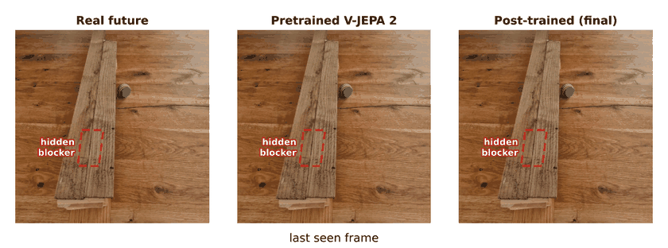</p>

*Figure 1. A pass that emerges on the far side. Left: the real future, read by the ball probe. Centre: the
pretrained V-JEPA 2 loses the ball under the plank. Right: the final post-trained model predicts it emerging.
Cyan marks where the probe locates the ball (opacity = probe confidence).*

## Contents

1. [Quick start](#quick-start)
2. [Problem statement and data](#1-problem-statement-and-data)
3. [Architecture and measurement](#2-architecture-and-measurement)
4. [Post-training V-JEPA 2](#3-post-training-v-jepa-2)
5. [Robustness](#4-robustness)
6. [The table slope](#5-the-table-slope)
7. [From forecast to gripper policy](#6-from-forecast-to-gripper-policy)
8. [Conclusion, impact and outlook](#7-conclusion-impact-and-outlook)
9. [How to run](#8-how-to-run)
10. [References](#references)

## Quick start

```bash
pip install -e .                                   # clip pipeline and evaluation tools
robustworld data/raw/videos/whole.mp4              # video -> tracked, labelled 3 s clips
python -m pytest tests/                            # includes the evaluation-isolation test
```

Post-training runs on a GPU (Kaggle, 2x T4) through `notebooks/kaggle_plan.ipynb`; the gripper runs on CPU. Full
instructions, including the weights of the best run and prediction with V-JEPA 2, are in [How to run](#8-how-to-run).

| model name used throughout | definition |
|---|---|
| Pretrained V-JEPA 2 | ViT-L V-JEPA 2 as released, no post-training |
| Two-way post-trained model | predictor post-trained for 20 epochs on passes from both entry directions (motion-weighted loss with contrast, loss-weighted sampling) |
| **Final model** | the two-way post-trained model, fine-tuned for 5 further epochs with added open-table rolling clips |

## 1. Problem statement and data

### 1.1 Why this scene

The scene is designed so that success is unambiguous and can be checked automatically. Whether a pass is blocked
is a **discrete, unobservable state of the scene**: no single frame reveals the blocker, so it can only be inferred
from experience of many passes, while the outcome of every pass is plainly visible in the video. The task also
demands **object permanence**, since the ball must persist in the prediction while fully occluded, and a
**distribution over outcomes**, since passes near the blocker's edges can go either way. That is precisely the
regime in which deterministic fine-tuning tends to average the possible futures into a blur. Finally, the slight
table tilt adds a weaker, continuous effect (the slope) alongside the discrete one, giving two levels of difficulty
within one scene.

The blocker leaves two openings under the plank: a **wide gap** (about 82 px along the plank, 104–186 px) and a
**narrow gap** (about 52 px, 315–367 px). Passes elsewhere are blocked. The narrow gap is the harder case
throughout this work, because fewer passes go through it and its edges sit close to the blocker.

### 1.2 Data collection and processing

The data are one fixed overhead phone recording of a hand-rolled ball, rolled from both sides of the plank. The
blocker was not moved during recording; its fitted extent is the same in the first and last 14 minutes (178–320 px
vs 194–325 px along the plank). This yields **254 passes from the right** (111 through, 77 hidden, 66 bounce), used
as the training direction, **83 from the left** (32 through, 48 bounce, 3 hidden), and open-table clips in which the
ball rolls freely. A separate recording with an **orange ball** and a different camera angle (57 passes) is held
out entirely as an unseen-object test.

The pipeline (`src/robust_world/pipeline.py`; reference in [docs/PIPELINE.md](docs/PIPELINE.md)) needs no manual
labelling. A colour tracker locates the ball in every frame and a hand detector flags frames containing a hand.
Each approach to the plank becomes a 3 s clip (48 frames at 16 fps, 512x512) whose first half, the *context*, ends
immediately before the ball touches the plank; the second half, the *target*, is what the model must predict.
Outcomes (*through*, *bounce* or *hidden* within 1.5 s) follow from fixed rules on the ball track and are used for
scoring only. Clips in which a hand touches the ball are excluded.

<p align="center">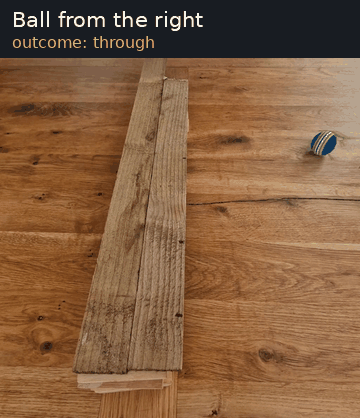</p>

*Figure 2. Sample clips: the three outcomes from the training direction, a pass from the opposite direction, and
stills of the held-out orange ball.*

<p align="center">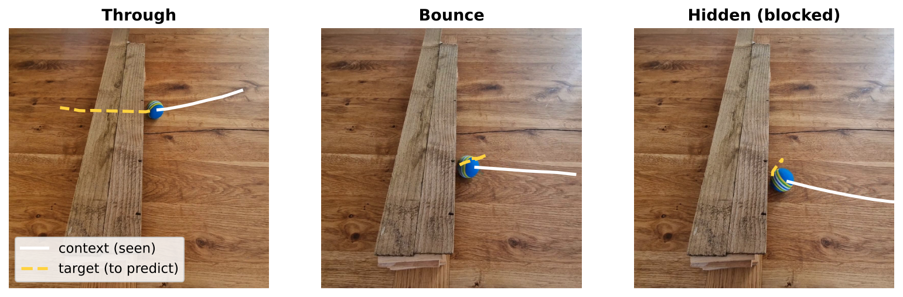</p>

*Figure 3. The three outcome classes, shown on the last context frame. White: the observed context track (circle =
start). Yellow: the target track the model must predict. "Bounce" and "hidden" are both blocked passes.*

## 2. Architecture and measurement

### 2.1 Why a latent world model rather than a generative video model

Three generative video models, Wan 2.1 [1], Cosmos [2] and LTX-Video [3] (runners in `models/`), were evaluated
zero-shot and did not meet the requirements of the problem. Pixel generation spends capacity on texture and
lighting that carry no information about the blocker; their outputs were frequently blurry or physically
implausible and had to be re-tracked before they could be scored. Billion-parameter diffusion models are also
expensive to adapt on a few hundred clips and prone to overfitting at that scale, and iterative denoising is too
slow for a robot control loop.

V-JEPA 2 [4] instead predicts in a learned latent space, following the Joint-Embedding Predictive Architecture
[5, 6]. Its targets abstract away unpredictable pixel detail, which suits multi-modal outcomes; its predictor can be
post-trained alone with the encoder frozen, which is cheap and keeps the probe's input fixed; and one forward pass
produces the forecast. The same architecture already supports zero-shot robot planning (V-JEPA 2-AC [4]), and
self-supervised video pretraining of this kind yields measurable intuitive-physics understanding [7], in line with
the case for predictive world models as the basis of autonomous agents [8]. The trade-off is that a latent model
produces no human-viewable frames: its predictions are only as legible as the readout used to decode them, which
motivates the measurement design in Section 2.3.

### 2.2 Architecture and what is trained

Each 1.5 s half-clip is resized to 256x256 and split into 2x16x16 tubelets, giving a 12x16x16 grid of $N = 3072$
tokens per half.

- **Encoder** $E_\theta$: ViT-L (24 layers, width 1024, about 300 M parameters). It maps the context frames to tokens
  $z_c = E_\theta(x_{1:24}) \in \mathbb{R}^{N \times 1024}$, encoded on their own so that nothing leaks from the
  future. **Frozen throughout.**
- **Predictor** $P_\phi$: a narrower transformer (12 layers, width 384). A linear map projects $z_c$ to width 384,
  learned mask tokens with positional embeddings mark the target positions, and a linear map projects the outputs
  back to 1024, giving the predicted target tokens $\hat z_t = P_\phi(z_c) \in \mathbb{R}^{N \times 1024}$.
  **All predictor weights $\phi$ are updated**: input and output projections, mask tokens and every transformer block.

Post-training is therefore not an extra matrix added after the model. It is a full update of the predictor that maps
observed scene tokens to future scene tokens, with the representation $E_\theta$ held fixed. The prediction target
is the layer-normalised encoder output of the real target half, $\bar z_t = \mathrm{LN}(z_t)$, as in V-JEPA 2's
pretraining.

**Objective.** The final configuration minimises a motion-weighted latent L1 loss plus a contrastive term:

$$
\mathcal{L}(\phi) = \underbrace{\frac{\sum_i w_i \,\lVert \hat z_{t,i} - \bar z_{t,i} \rVert_1}{D \sum_i w_i}}_{\text{motion-weighted L1}}
\;+\; \lambda \underbrace{\left(-\log \frac{\exp(-d(\hat z_t, \bar z_t)/\tau)}{\sum_{c \in \mathcal{C}} \exp(-d(\hat z_t, \bar z_c)/\tau)}\right)}_{\text{InfoNCE over other clips' futures}}
$$

$$
w_i = 1 + \alpha\, \frac{m_i}{\overline{m}}, \qquad m_i = \max\big(\lVert \Delta \bar z_{t,i} \rVert_1,\ \lVert \Delta \hat z_{t,i} \rVert_1\big)\ \text{(no gradient)}
$$

Here $i$ indexes tokens, $D = 1024$, $\Delta$ is the change from the previous time step, $\overline{m}$ is the mean
of $m$ over the clip, and $d$ is the same weighted L1 distance. The candidate set $\mathcal{C}$ holds the clip's own
real future, the other clips in the batch and 8 stored futures of other training clips. Settings: $\alpha = 4$,
$\lambda = 0.1$, $\tau = 0.02$; AdamW with learning rate $3 \times 10^{-5}$ and weight decay 0.04; effective batch 8
(2 clips x 4 accumulation steps); cosine schedule with 10% warm-up; fp16 with gradient checkpointing on a T4. Clips
are drawn each epoch with probability $p_k \propto \max(\ell_k, 0.25\,\bar\ell)$, where $\ell_k$ is clip $k$'s loss
in the previous epoch. The open-table fine-tune continues from these weights with the same loss for 5 epochs.

**Why each term.** The *weights* $w_i$ address imbalance: the ball covers about 1.5% of the tokens, so an
unweighted loss is dominated by the static table and can be minimised while ignoring the ball. Taking the maximum
of real and predicted change makes a missed ball and a phantom ball equally costly, so the model cannot lower the
loss by hallucinating motion, and the weights carry no gradient, so it cannot lower them by suppressing motion
either. The *contrastive term* addresses averaging: an L1-optimal prediction under uncertainty is a blend of the
possible futures, and a blend of "through" and "hidden" lies equally far from both, so it cannot single out its own
clip among the candidates. InfoNCE [9] therefore rewards predictions that commit to one specific, identifiable
future, which is what the probe needs to read a clear ball.

### 2.3 A probe that cannot learn the blockade

The ball is read out of any set of tokens, real or predicted, by a linear probe
(`models/vjepa2/eval_decoder.py`):

$$
P(\text{ball in cell } j) = \sigma\big(w^\top \mathrm{LN}(z_j) + b\big), \qquad w \in \mathbb{R}^{1024}
$$

It is fitted once, by logistic regression, on **real context-half tokens only**, labelled with the tracker's ball
position in the same frame. On real frames it locates the ball almost perfectly (cell AUROC ≈ 1.00; median error
14–20 px on a 512 px frame). A pass's through-vs-blocked score is the peak probability, over the 12 predicted steps,
that the ball is beyond the plank; applied to real future frames this score separates outcomes at AUROC 0.998.

A readout trained on predictions or on outcomes could itself learn where the blocker is, and the experiment would
then measure the readout rather than the world model. Five properties rule this out. First, the probe's training
data contain no outcomes, no target-half frames and no predictions; because the context half ends before the ball
reaches the plank, it has never seen a ball under or beyond the plank, or a blocked ball. Second, it is linear, so
it can only report what is already linearly present in the tokens. Third, it sits on the frozen encoder's feature
space and is identical for the pretrained, two-way and final models, so every difference between them comes from
the predictor. Fourth, the function that builds its training data (`examples_from`) accepts only a context encoding
and same-frame labels, with no parameter through which anything else could be passed. Fifth,
`tests/test_eval_isolation.py` checks that the fitted probe stays **bit-for-bit identical** when outcomes,
target-half labels or predicted features are scrambled, and that no other readout is trained on V-JEPA features.
Outcomes are used only to *score* the probe's readings, never to fit anything between the model and the score.

## 3. Post-training V-JEPA 2

### 3.1 The core difficulty: multi-modal futures

A plain regression loss is minimised by the *mean* future. Because the loss is dominated by the static background,
where a pass could go either way the cheapest prediction is a faint, smeared ball or, more often, no ball at all.
The pretrained model shows the extreme case: it almost never predicts the ball beyond the plank and so effectively
predicts "blocked" for every pass (Figure 1, centre). Every technique evaluated below targets this hedging in a
different way.

### 3.2 Techniques evaluated

All variants were trained with identical folds, data and budget (10 epochs, passes from the right) and scored
through the same frozen probe, so their results are directly comparable; the best was then carried forward.

<p align="center">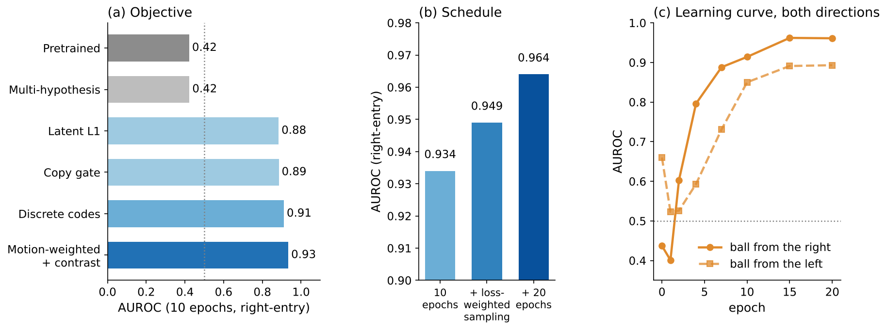</p>

*Figure 4. (a) Through-vs-blocked AUROC for each objective after 10 epochs on the right-entry set (pretrained: 0.42
on this set; dotted line = chance). (b) Effect of the training schedule on the best objective. (c) Learning curve of
the two-way model, scored at saved epochs on both entry directions.*

| technique | AUROC | outcome | reason |
|---|---|---|---|
| Plain latent L1 (V-JEPA 2's objective) | 0.88 | baseline | learns the blockade, but by small ranking shifts; still hedges |
| **Motion-weighted L1 + contrast** | **0.93** | **kept** | first clearly visible predicted balls beyond the plank |
| Discrete codes (k-means grouping of tokens) | 0.91 | not kept | sharp in the wide gap, poor in the narrow gap |
| Copy-last-frame gate | 0.89 | no effect | background was not the bottleneck |
| Multiple hypotheses, winner-takes-all | 0.42 | failed | collapsed onto one "no ball" future |
| Autoregressive rollout | 0.415 (pretrained) | not kept | no gain at baseline; much higher training cost |
| **Loss-weighted sampling** | **0.95** | **kept** | more updates on rare, hard passes |
| **20-epoch schedule** | **0.96** | **kept** | narrow gap learnt; largest single gain |
| **Both entry directions** | 0.96 / 0.89 | **kept** | needed to transfer across directions (Section 4.1) |
| **Open-table fine-tune** | 0.97 / 0.87 | **kept** | keeps the ball visible for slope measurement |

**Plain latent L1.** Post-training with V-JEPA 2's own loss already raises AUROC from 0.42 to 0.88, confirming that
the predictor can absorb the blockade at all. The gain, however, comes from small ranking shifts: the predicted
P(blocked) stays near 1 for almost every pass, because the loss still rewards hedging.

**Motion-weighted L1 with contrast.** For the reasons given in Section 2.2, this objective makes a missing or
phantom ball costly and penalises blends of futures. It produced the first clearly visible predicted balls beyond
the plank and the best 10-epoch score. At 10 epochs it learnt only the wide gap.

**Discrete codes.** Target tokens were grouped by k-means into 256 codes and the predictor trained to classify each
token's code, so it must choose between "ball" and "no ball" instead of averaging them. It gave the sharpest
predictions in the wide gap (0.85 predicted vs 0.95 real probability of a ball beyond the plank) but lagged in the
narrow gap (0.49 vs 0.91), because snapping to a fixed codebook discards the fine detail that distinguishes a partly
visible ball.

**Copy gate.** A learned per-token gate that copies the last context frame was intended to free the predictor from
reconstructing the static background. It changed nothing (0.885 vs 0.884): the background was already predicted
well, so capacity was not the bottleneck.

**Multiple hypotheses.** Several predicted futures with a learned picker should, in principle, represent "through"
and "hidden" separately. In practice training collapsed onto a single "no ball" future, with early best epochs and
one fold overfitting. Winner-takes-all training is known to need careful balancing to avoid such collapse [10], and
254 clips gave too little signal to separate the modes.

**Autoregressive rollout.** Predicting one step at a time and feeding each prediction back was evaluated on the
pretrained predictor, where it gave no gain over one-pass prediction (0.415 vs 0.422). Because it multiplies the
cost of every training step by the number of steps, one-pass prediction over the full 1.5 s, as in V-JEPA 2, was kept.

**Loss-weighted sampling and a longer schedule.** Drawing clips in proportion to their previous-epoch loss
concentrates updates on the rare, hard passes near the blocker's edges without using any outcome label. With 20
epochs, the predicted probability of a ball beyond the plank in the narrow gap rose from 0.44 to 0.79 (real frames
0.91). Most of the gain came in the second 10 epochs, and learning plateaus at about epoch 15 (Figure 4c).

**Both directions and the open-table fine-tune.** Training on passes from both sides was required for the blocker to
transfer across directions (Section 4.1) and cost nothing on the training direction (0.961 vs 0.964). Five further
epochs with free-rolling clips keep the predicted ball visible on open table in 87% of clips at 1.5 s, against 57%
before, which made the slope measurable (Section 5) while leaving the blockade scores unchanged within their
intervals.

> **Summary of what worked.** The gains came from *how the predictor is trained*, not from changes to its
> architecture. A loss that makes hedging costly, sampling that emphasises hard passes, and a longer schedule each
> added accuracy; training length gave the single largest gain. Architectural additions (copy gate, multiple
> hypotheses, discrete codes) did not improve on this, either because they targeted a bottleneck that was not present
> or because 254 clips were too few to train them.

### 3.3 Results

<p align="center">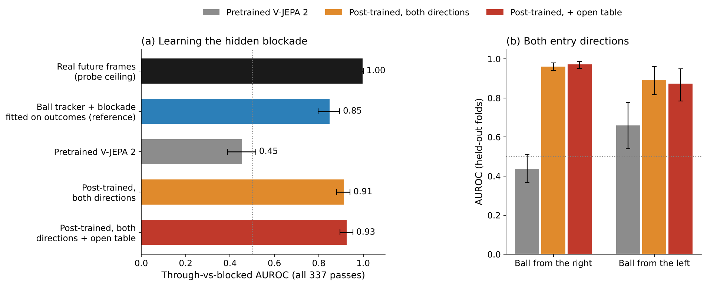</p>

*Figure 5. Through-vs-blocked AUROC on held-out folds (95% bootstrap intervals over clips; dotted line = chance). (a)
All 337 passes; the tracker reference fits its blockade range on outcomes and is shown for comparison only. (b) By
entry direction.*

| model | AUROC, all passes | from the right | from the left |
|---|---|---|---|
| Real future frames through the probe (ceiling) | 0.998 | – | – |
| Pretrained V-JEPA 2 | 0.45 | 0.44 | 0.66 |
| Ball tracker + blockade fitted on outcomes (reference) | 0.85 | – | – |
| Two-way post-trained model | 0.91 | 0.96 | 0.89 |
| **Final model** | **0.93** | **0.97** | **0.87** |

The post-trained models exceed the tracker reference even though that reference is fitted directly on outcomes. A
paired bootstrap of the gain over the pretrained model on the same clips excludes zero for every successful run, and
the left-side difference between the two-way and final models (−0.02) is well inside its interval.

<p align="center">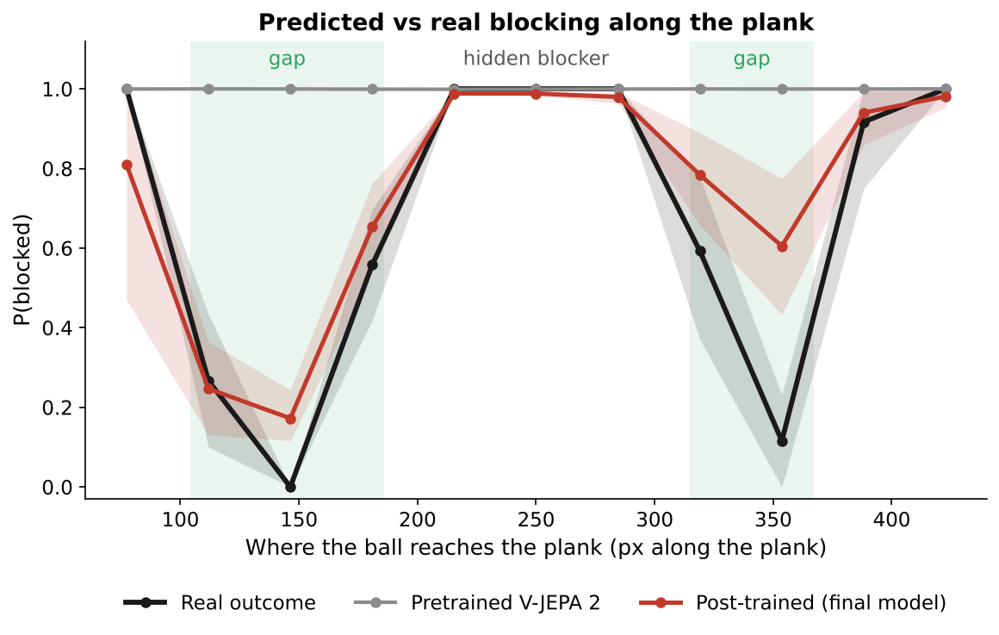</p>

*Figure 6. Probability that a pass is blocked, binned by where the ball reaches the plank (all 337 passes; mean and
95% bootstrap interval per bin). The pretrained model predicts "blocked" everywhere; the final model recovers both
gaps.*

**The narrow gap is learnt less well than the wide one.** In the wide gap the final model's mean predicted P(blocked)
falls to 0.25 against a real rate of 0.11. In the narrow gap it falls only to 0.57 against the same real rate, so many
passes that go through the narrow gap are still predicted blocked. Three factors explain this. Fewer
passes traverse the narrow gap (33 through, against 106 for the wide gap), so it contributes about a third as many
training examples. It is about 37% narrower (52 px vs 82 px), so a small
error in the predicted crossing point moves a pass onto the blocker. And its edges lie close to the blocker, where
outcomes are genuinely ambiguous and the loss still favours a cautious prediction. Loss-weighted sampling and the
longer schedule narrowed this gap in performance (Section 3.2) but did not close it; more passes through the narrow
gap would be the most direct remedy.

<p align="center">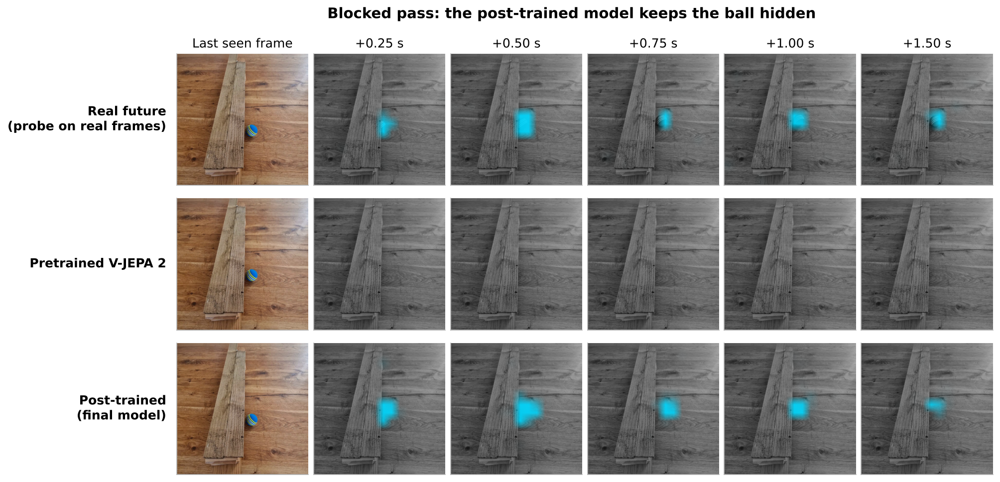</p>

*Figure 7. A blocked pass, predicted 0.25–1.5 s ahead. The final model holds the ball at the plank's edge, matching
the real outcome, rather than predicting it through. Prediction panels are drawn on the empty scene.*

> **Summary.** The final model predicts which passes are blocked nearly as well as reading the real future frames
> through the same probe (0.97 vs 0.998 from the training direction), and better than a tracker fitted on outcomes.
> Its main remaining weakness is the narrow gap.

## 4. Robustness

### 4.1 The opposite entry direction

A model post-trained only on passes from the right becomes *worse* on passes from the left (AUROC 0.64 to 0.36),
and mirroring the left clips does not recover it. The single-direction model learns an image-space outcome map ("at
these heights the ball ends up on the left") rather than a direction-independent representation of a solid object;
applied to balls from the left, that map is exactly inverted. Post-training on both directions jointly resolves this,
reaching 0.89 (two-way model) and 0.87 (final model) on held-out left-entry passes with no loss on the right (Figure
5b). Only 6 left-entry passes reach the narrow gap, so narrow-gap estimates from that side are noisy.

### 4.2 A held-out object: the orange ball

The final model, unchanged, is scored on 57 passes with an orange ball that never appears in training, filmed from a
different camera angle. A model that has learnt the *scene* rather than the training ball should be insensitive to
the ball's appearance.

> **Results pending (test in progress).** AUROC: _to be added_.

### 4.3 Interpretability: isolating ball appearance

The aim is to identify a latent direction that encodes the ball's appearance (colour), separate from the components
that encode position, velocity and motion. The direction is estimated from real context tokens only, as the mean
difference between ball-cell tokens of the orange and blue balls, labelled by which ball is present and never by
outcomes or predictions. Projecting it out of the context before the predictor tests whether the scene knowledge
(blockade, slope) is independent of the object's appearance.

> **Results pending (analysis in progress).**

> **Summary.** The blockade generalises across entry directions once both are observed in training; a single
> direction is not enough. Cross-object generalisation (Section 4.2) will establish whether the learnt property
> belongs to the scene rather than to the training ball.

## 5. The table slope

The table slopes slightly downhill to the left. The slope is measured label-free on each predicted track as

$$
s = \tfrac{1}{2}\left(a_{\text{downhill}} - a_{\text{uphill}}\right)
$$

where $a$ is the acceleration along the direction of motion, compared over stretches of matched speed so that
rolling friction, which always opposes motion, cancels. Units are ball diameters per step² (one step = 1/8 s). The
frozen probe recovers only about half of the real pull even from real frames (0.014 vs 0.025), so a model that has
learnt the slope should approach the probe-on-real value rather than the tracker value.

<p align="center">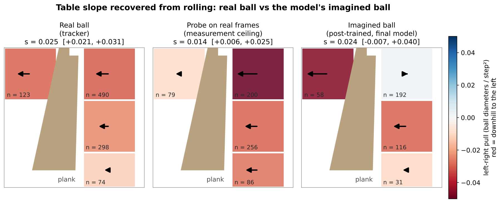</p>

*Figure 8. Left-right acceleration from the table after removing friction (red = downhill, to the left; arrows =
pull). Per-cell fits are smoothed with the same stretch-weighted Gaussian kernel (σ = 130 px) in every panel, and
regions with too few track stretches are left blank. The pretrained model is omitted: its predicted ball is never
visible on open table, so no stretches exist.*

| track | s (ball diameters / step²) | 95% interval |
|---|---|---|
| Real ball (tracker) | 0.025 | 0.021 to 0.031 |
| Probe on real frames (attainable value) | 0.014 | 0.006 to 0.025 |
| Two-way post-trained model | 0.019 | −0.018 to 0.051 |
| **Final model** | **0.024** | **−0.007 to 0.040** |

> **Summary.** The final model pulls the predicted ball downhill at or above the probe's attainable level over most
> of the table, and the open-table fine-tune nearly doubles the number of measurable stretches. The upper-right
> region, where most balls enter at speed, shows little pull, and the interval still includes zero, so the slope is
> **likely learnt but not proven**. A conclusive result requires more open-table rolling or a steeper tilt: the slope
> is limited by data, not by the model.

## 6. From forecast to gripper policy

### 6.1 Interface between world model and policy

The policy receives a compact forecast extracted from the predicted future through the frozen probe: **whether** the
ball emerges ($p$, the through-vs-blocked score), **where** along the plank edge, **when**, **how fast**, and **how
uncertain** these are. The uncertainty $u \in [0, 1]$ is derived from how spread out the predicted ball is beyond the
plank (or, failing that, how weak), and sets standard deviations $\sigma_s = 0.12u$ m for position,
$\sigma_t = 0.3u$ s for timing and $\sigma_v = 0.5u\,\lvert v \rvert$ for speed; $u = 1$ means no information. This
interface does not depend on the robot's embodiment or on the world model's internals.

### 6.2 Problem design

The task is constructed so that a better forecast must translate into better behaviour. The gripper must commit
before the ball is visible: its fingers close at most 0.15 m/s and open at most 9 cm for a 4 cm ball, so it cannot
simply react to every ball once it appears. Earlier, less constrained configurations (a wider, faster gripper) were
tested and let the policy react after the ball appeared, so even a good forecast carried no value; the constraints
above are what make the forecast matter.

### 6.3 Simulation and policy training

The gripper is simulated in PyBullet [11] (`models/gripper/`). Only the grasp of a single rolling ball is modelled,
so a lightweight rigid-body simulator gives fast, reproducible training on a laptop CPU; heavier robotics stacks add
fidelity this task does not need. Each episode replays a real exit (position, time and velocity from the tracker,
with small jitter).

**Observation, action and reward.** The observation $o_t \in \mathbb{R}^{17}$ contains the forecast
$(\hat x, \hat t - t, \hat v)$ and its stated $(\sigma_s, \sigma_t, \sigma_v)$, the gripper's position and finger
opening, and, once the ball is visible, a fit of its observed position and velocity. The action
$a_t \in [-1, 1]^4$ sets the gripper's velocity in two directions, the finger opening and a grasp trigger, every
1/16 s. The episode reward is

$$
r =
\begin{cases}
1 + 0.5\,(1 - \delta) - 0.3\,g - c_{\text{move}} & \text{ball lifted and held} \\
-1 - c_{\text{move}} & \text{miss}
\end{cases}
$$

where $\delta \in [0, 1]$ is how deep into the catch zone the grasp happened (earlier is better), $g \in [0, 1]$ is
how wide the fingers were open, and $c_{\text{move}}$ is a small cost on distance travelled.

**Training.** The policy $\pi_\psi(a \mid o)$, a two-layer MLP (128 units per layer), is trained with PPO [12] by
maximising the clipped surrogate objective

$$
\mathcal{L}^{\text{CLIP}}(\psi) = \mathbb{E}_t\Big[\min\big(\rho_t(\psi)\,\hat A_t,\ \mathrm{clip}(\rho_t(\psi), 1 - \epsilon, 1 + \epsilon)\,\hat A_t\big)\Big] + \beta\,\mathcal{H}[\pi_\psi],
\qquad \rho_t(\psi) = \frac{\pi_\psi(a_t \mid o_t)}{\pi_{\psi_{\text{old}}}(a_t \mid o_t)}
$$

with advantages $\hat A_t$ from generalised advantage estimation [13] ($\gamma = 0.99$, $\lambda = 0.95$),
$\epsilon = 0.2$, entropy weight $\beta = 0.003$, learning rate $3 \times 10^{-4}$, 512-step rollouts and 10 update
epochs, for 2.5 M steps per fold over 5 folds (Stable-Baselines3 [14]). During training each episode draws
$u \sim \mathcal{U}(0, 1)$ and a forecast equal to the true exit plus Gaussian noise of exactly the stated size,
$\hat x = x + \varepsilon$ with $\varepsilon \sim \mathcal{N}(0, \sigma_s^2)$, and likewise for timing and speed.
The policy therefore learns how much to trust a forecast from its stated uncertainty. It is then **frozen** and
evaluated on real passes with each world model's forecast, and it never sees a world model's real forecast paired
with a real outcome. The trade-off is that the policy must be calibrated to the uncertainty the world model actually
reports; in exchange, one policy serves every world model and the comparison between world models is not confounded
by policy training.

**Decision to set off.** Before the ball can emerge, the gripper decides whether to move at all. With $c(u)$ the
frozen policy's simulated pick-up rate at uncertainty $u$ (Figure 9), it sets off if and only if

$$
p\,\big[c(u)\,(R_{\text{pick}} + \bar e) - (1 - c(u))\,R_{\text{miss}}\big] - (1 - p)\,R_{\text{waste}}
\;>\; -p\,R_{\text{let go}} + (1 - p)\,R_{\text{hold}}
$$

with the evaluation rewards $R_{\text{pick}} = 3$ (plus a mean early bonus $\bar e = 0.25$), $R_{\text{miss}} = 0.5$,
$R_{\text{waste}} = 1$ for a trip to a blocked ball, $R_{\text{let go}} = 1$ for staying when the ball emerges, and
$R_{\text{hold}} = 0.5$ for correctly holding back. Nothing in this rule is fitted to real data.

### 6.4 How uncertainty drives behaviour

<p align="center">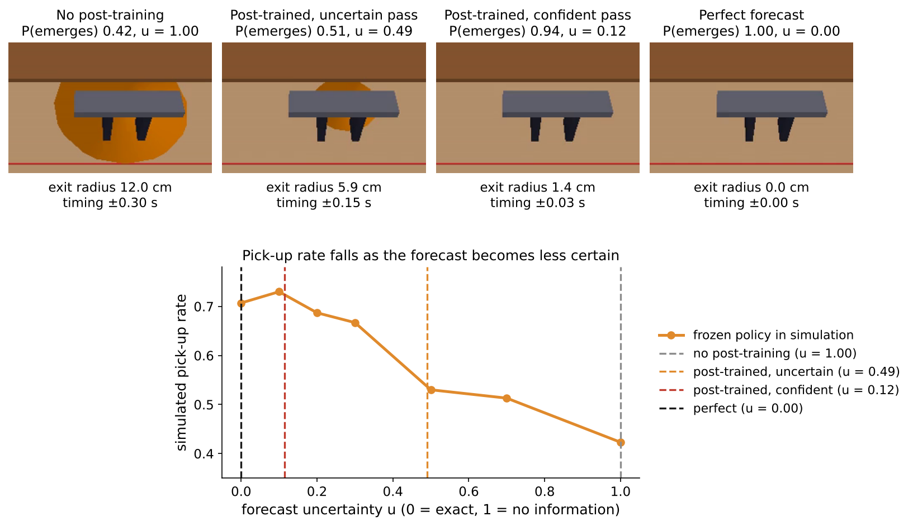</p>

*Figure 9. Top: the frame before the ball appears, for four forecasts. The orange disc is the forecast exit region;
its radius is $\sigma_s$, and the gripper lines up on its centre. Below about 2 cm the disc is hidden by the fingers.
Bottom: simulated pick-up rate $c(u)$ of the frozen policy against forecast uncertainty, with the four forecasts
marked.*

The pretrained model's forecast carries no information ($u = 1$, a 12 cm exit region), so the policy can only guess
and picks up 42% of balls in simulation. The post-trained model reports its own confidence: on an uncertain pass the
region is 6 cm wide, on a confident pass under 2 cm, and the pick-up rate rises accordingly towards the 71% achieved
with a perfect forecast.

### 6.5 Results

Mean reward per pass over all 335 real passes (141 emerge, 194 blocked):

| forecast given to the frozen policy | sets off (emerges / blocked) | picks up | mean reward |
|---|---|---|---|
| none, or pretrained V-JEPA 2 | 100% / 100% | 43% | −0.08 |
| **two-way post-trained model** | **72% / 4%** | 60% of attempts | **+0.69** |
| perfect forecast (tracker) | 100% / 0% | 73% | +1.27 |

| | no post-training | post-trained | perfect forecast |
|---|---|---|---|
| **Blocked pass** | 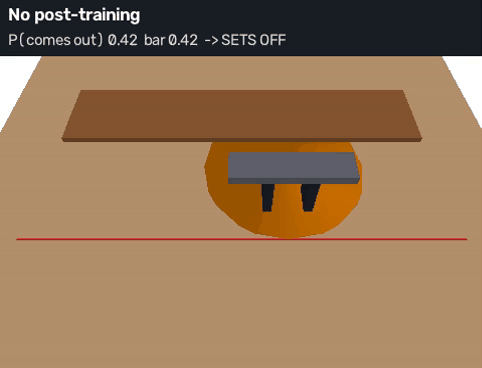 |  | 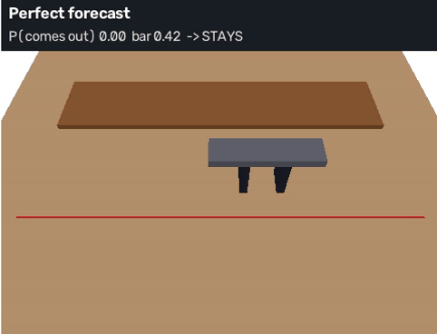 |
| **Emerges, uncertain forecast** | 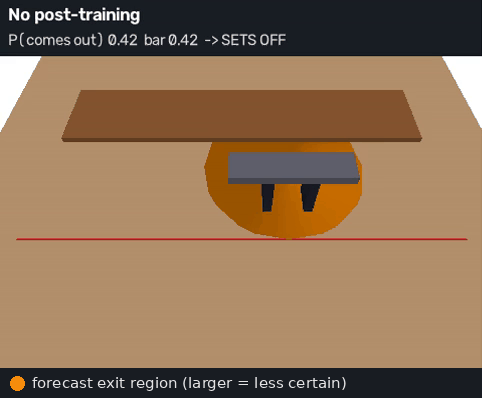 | 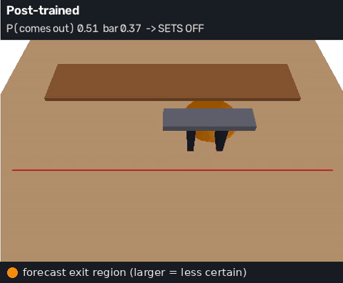 | 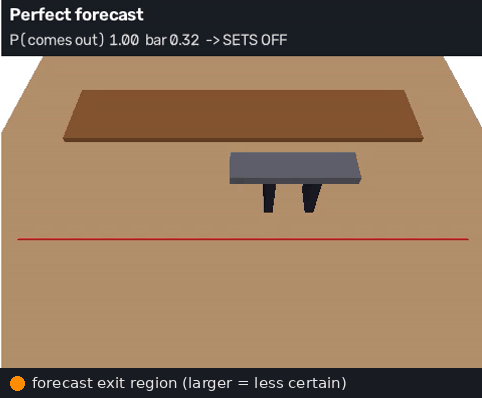 |
| **Emerges, confident forecast** |  | 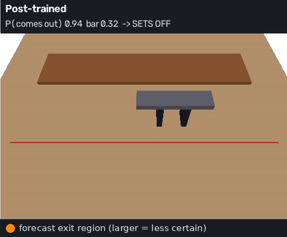 | 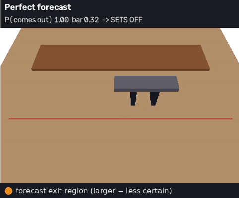 |

*Figure 10. The same frozen policy driven by three forecast sources on three real passes. Each header shows P(comes
out), the decision threshold and the decision. Without post-training the gripper sets off for every ball, including
blocked ones; with the post-trained forecast it holds back on the blocked pass and lines up on the emerging ones.*

> **Summary.** The post-trained forecast is worth most of the gap between no information and perfect information
> (+0.69 of a possible +1.27, from −0.08). The gain comes mainly from *not* setting off for blocked balls (4% wasted
> trips instead of 100%). The remaining gap is mostly passes that emerge but are predicted blocked, chiefly through
> the narrow gap (Section 3.3).

### 6.6 What transfers to other robots, and what does not

The system splits into three layers with different reach. **The scene model transfers to any robot that observes
the scene from the same viewpoint.** The post-trained predictor, the probe and the forecast interface (*arrive,
where, when, how fast, how sure*) contain no gripper-specific information, so a different arm or a humanoid can
consume the same forecast without retraining the world model. **The forecast's coordinates transfer with a
calibration step.** Positions are read in image pixels, so another robot needs the camera-to-robot transform to
express them in its own frame; a moving camera would additionally require a world-fixed readout. **The low-level
policy does not transfer.** The PPO policy is tied to this gripper's action space, its finger speed and opening
limits, its observation layout and a reward tuned to its catch geometry, and the set-off rule uses this gripper's own
catch-rate curve $c(u)$. A different robot needs its own low-level controller, which is the cheapest part to obtain
because it is trained in simulation.

**A concrete route for a generalist policy: Octo.** Octo [15] is an open-source transformer policy whose inputs are
tokenised modality by modality, and which was designed to be fine-tuned to **new observation inputs and new action
spaces** by adding a lightweight tokenizer and head while keeping the pretrained backbone. The forecast vector would
enter as an additional low-dimensional observation token alongside the camera tokens, and Octo would be fine-tuned
on demonstrations generated in simulation by the PPO policy above, which supplies unlimited, perfectly labelled
trajectories for any embodiment that can be simulated. Octo suits this because its tokenised inputs accept a new
sensor-like signal without architectural change and it fine-tunes on a single GPU from a few hundred
demonstrations. π0 [16] is a viable alternative through its proprioceptive state input, at higher compute cost.
OpenVLA [17] conditions only on an image and a language instruction, so the forecast would have to be rendered into
the image or the prompt, which discards its numerical precision. This fine-tune has not been run; it is the natural
next step for carrying the result to a general-purpose manipulator.

## 7. Conclusion, impact and outlook

### 7.1 Conclusion

Self-supervised post-training of V-JEPA 2 on a few hundred home-recorded clips teaches it an invisible blockade
(AUROC 0.44 to 0.97), measured through a readout that provably cannot have learnt it. The decisive ingredients were a
loss that penalises hedging, loss-weighted sampling, a longer schedule and training on both entry directions;
architectural additions did not improve on them. The knowledge generalises across entry directions once both are
observed, the narrow gap remains the weakest case, and the table slope is likely recovered. A frozen gripper policy
converts the forecast into behaviour: mean reward rises from −0.08 to +0.69 per pass, chiefly by not pursuing balls
that will not emerge, against +1.27 for a perfect forecast.

### 7.2 Impact and applications

Homes contain hidden, persistent state: a drawer that sticks, an object behind another, an uneven floor, a door that
swings back. A robot that post-trains its world model on its own observations of one home can learn such properties
without labels and plan around them. World models are increasingly positioned as the predictive layer of robot
systems, from latent predictive models used for planning [4, 8] to generative world models for humanoids [18, 19],
and recent surveys frame them as a route to physical reasoning in manipulation [20, 21]. This work contributes a
verifiable test of the property those systems rely on: that scene-specific physics can be acquired from passive
video and measured independently of the readout. Latent prediction also needs only one forward pass per forecast,
which suits on-board inference on power-limited humanoid hardware better than iterative video generation.

### 7.3 Handheld and egocentric video

Large egocentric datasets [22] and handheld data-collection tools [23] show that human-held cameras are the scalable
source of home video. Handheld video introduces camera motion; latent models are better placed than pixel
generators to absorb it, but the probe and the slope measurement would need to operate in a camera-stabilised or
world-fixed frame.

### 7.4 Limitations and next steps

The study uses one scene, one blocker position and a single training seed with 5-fold cross-validation; the
left-entry set contains only 3 hidden passes; the predicted ball remains fainter than the real one in the narrow
gap; the slope interval includes zero; and the gripper is evaluated in simulation on real trajectories rather than
on hardware. The most informative next steps are a moved-blocker recording to test adaptation, the cross-object test
of Section 4.2, fine-tuning Octo on the forecast (Section 6.6), and hardware evaluation.

## 8. How to run

### 8.1 Clips

Place the videos in `data/raw/videos/` and run `robustworld data/raw/videos/` (see [docs/PIPELINE.md](docs/PIPELINE.md)).
`scripts/cut_open_clips.py` cuts the open-table clips and `scripts/pack_clips.py` packages the clips for Kaggle.

### 8.2 Post-training the final model on Kaggle

Open `notebooks/kaggle_plan.ipynb` (GPU 2x T4; attach the `GITHUB_TOKEN` secret and the clips dataset) and Save &
Run All. The notebook runs `models/vjepa2/plan.py`; to repeat only the best runs:

```bash
python models/vjepa2/plan.py run --only lossmix_both-after --redo     # two-way post-trained model (~5.6 h)
python models/vjepa2/plan.py run --only lossmix_topup-after --redo    # final model: + 5 epochs open table
```

### 8.3 Weights

Fold weights (`fold0.pt`–`fold4.pt`) exceed GitHub's file limits and are kept in the Kaggle notebook outputs:
`weights/lossmix_both-after/` (two-way model) and `weights/lossmix_topup-after/` (final model). Attach that output,
or a Kaggle dataset named after the run (e.g. `lossmix-both-after`), as a notebook input; `plan.py` locates it.

### 8.4 Predicting with V-JEPA 2

```bash
python models/vjepa2/ball_probe_cv.py --predictor-run <path>/weights/lossmix_topup-after \
    --manifest data/processed/clips/manifest_right.jsonl --out outputs/vjepa2/final
```

This writes `per_clip.json` (predicted ball position and visibility per step, and the through-vs-blocked score) and
`maps.npz` (probe maps per step). Saved scores for the pretrained, two-way and final models are in
`results/2026-10-04_2110_twoday/vjepa2/plan/scores/` (`both-before`, `lossmix_both-after`, `lossmix_topup-after`).
`python docs/figures/make_figures.py --clips data/processed/clips/whole` redraws every figure in this README.

### 8.5 Gripper (CPU)

The trained policies are committed in `models/gripper/runs/pb_narrow_fs/`.

```bash
pip install pybullet gymnasium stable-baselines3
cd models/gripper
export GRIPPER_ENV=pybullet GRIPPER_PARAMS='{"GAP_MAX": 0.09, "FINGER_SPEED": 0.15}'
PLAN=../../results/2026-10-04_2110_twoday/vjepa2/plan
python blockade_eval.py --plan $PLAN --tag pb_narrow_fs --v2                       # Section 6.5 table
python videos.py --plan $PLAN --policy runs/pb_narrow_fs --tag pb_narrow_fs --gui  # watch in PyBullet
```

Training (`train.py`) is described in [models/gripper/README.md](models/gripper/README.md).

## References

1. Wan Team. *Wan: Open and Advanced Large-Scale Video Generative Models.* 2025. [arXiv:2503.20314](https://arxiv.org/abs/2503.20314)
2. NVIDIA. *Cosmos World Foundation Model Platform for Physical AI.* 2025. [arXiv:2501.03575](https://arxiv.org/abs/2501.03575)
3. HaCohen et al. *LTX-Video: Realtime Video Latent Diffusion.* 2025. [arXiv:2501.00103](https://arxiv.org/abs/2501.00103)
4. Assran et al. *V-JEPA 2: Self-Supervised Video Models Enable Understanding, Prediction and Planning.* 2025. [arXiv:2506.09985](https://arxiv.org/abs/2506.09985)
5. Assran et al. *Self-Supervised Learning from Images with a Joint-Embedding Predictive Architecture.* CVPR 2023. [arXiv:2301.08243](https://arxiv.org/abs/2301.08243)
6. Bardes et al. *Revisiting Feature Prediction for Learning Visual Representations from Video.* 2024. [arXiv:2404.08471](https://arxiv.org/abs/2404.08471)
7. Garrido et al. *Intuitive Physics Understanding Emerges from Self-Supervised Pretraining on Natural Videos.* 2025. [arXiv:2502.11831](https://arxiv.org/abs/2502.11831)
8. LeCun. *A Path Towards Autonomous Machine Intelligence.* 2022. [OpenReview](https://openreview.net/forum?id=BZ5a1r-kVsf)
9. van den Oord, Li and Vinyals. *Representation Learning with Contrastive Predictive Coding.* 2018. [arXiv:1807.03748](https://arxiv.org/abs/1807.03748)
10. Rupprecht et al. *Learning in an Uncertain World: Representing Ambiguity Through Multiple Hypotheses.* ICCV 2017. [arXiv:1612.00197](https://arxiv.org/abs/1612.00197)
11. Coumans and Bai. *PyBullet, a Python module for physics simulation for games, robotics and machine learning.* 2016–2021. [pybullet.org](https://pybullet.org)
12. Schulman et al. *Proximal Policy Optimization Algorithms.* 2017. [arXiv:1707.06347](https://arxiv.org/abs/1707.06347)
13. Schulman et al. *High-Dimensional Continuous Control Using Generalized Advantage Estimation.* ICLR 2016. [arXiv:1506.02438](https://arxiv.org/abs/1506.02438)
14. Raffin et al. *Stable-Baselines3: Reliable Reinforcement Learning Implementations.* JMLR 22(268), 2021. [jmlr.org](https://jmlr.org/papers/v22/20-1364.html)
15. Octo Model Team. *Octo: An Open-Source Generalist Robot Policy.* RSS 2024. [arXiv:2405.12213](https://arxiv.org/abs/2405.12213)
16. Black et al. *π0: A Vision-Language-Action Flow Model for General Robot Control.* 2024. [arXiv:2410.24164](https://arxiv.org/abs/2410.24164)
17. Kim et al. *OpenVLA: An Open-Source Vision-Language-Action Model.* 2024. [arXiv:2406.09246](https://arxiv.org/abs/2406.09246)
18. *Humanoid World Models: Open World Foundation Models for Humanoid Robotics.* 2025. [arXiv:2506.01182](https://arxiv.org/abs/2506.01182)
19. *Generative World Modelling for Humanoids: 1X World Model Challenge Technical Report.* 2025. [arXiv:2510.07092](https://arxiv.org/abs/2510.07092)
20. *World Models for Robotic Manipulation: A Survey.* 2026. [arXiv:2606.00113](https://arxiv.org/abs/2606.00113)
21. *A Definition and Roadmap for World Models.* 2026. [arXiv:2607.06401](https://arxiv.org/abs/2607.06401)
22. Grauman et al. *Ego4D: Around the World in 3,000 Hours of Egocentric Video.* CVPR 2022. [arXiv:2110.07058](https://arxiv.org/abs/2110.07058)
23. Chi et al. *Universal Manipulation Interface: In-The-Wild Robot Teaching Without In-The-Wild Robots.* RSS 2024. [arXiv:2402.10329](https://arxiv.org/abs/2402.10329)
