# RobustWorld: learning an invisible blockade from home video

> **Branch `final/robustworld-summary`.** The clean, final summary of the project: only the code and
> results needed to run and reproduce the best world model (**G**) and the best gripper policy
> (**pb_narrow_fs**). Weaker runs stay on their original branches (`claude/colab-two-day-plan-3gn90a`,
> `claude/project-thread-yzzs6s`).

## Introduction

A robot that acts in a home has to predict things it cannot see. This project asks whether a world model
can learn a **hidden physical property of one scene purely by post-training on ordinary video**, and
whether a robot policy then gains from that knowledge.

The test scene is deliberately easy to verify. A ball rolls under a plank. A blocker hidden under the
plank stops some passes ("blocked"), while others come out the far side ("through"). Nothing in any
single frame shows where the blocker is, so the only way to know it is to have learnt it from watching
many passes. The table is also slightly tilted, which gives a second, subtler property to learn
(the slope).

We post-train the predictor of **V-JEPA 2** on these passes, read its imagined future through a frozen
ball probe, and feed that forecast to a **simulated two-finger gripper** that must pick the ball up once
it crosses a line.

**Sneak peek.** For a pass that goes through, the pretrained model loses the ball under the plank (middle
row). After post-training, the model imagines it coming out on the far side (bottom row), as it really
does (top row). Through-vs-blocked AUROC goes from **0.42 to 0.97**.

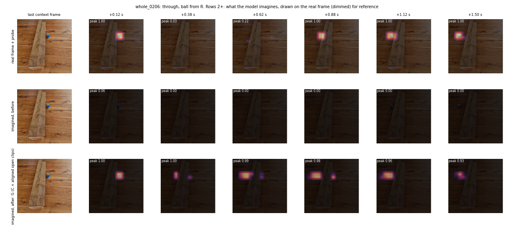

### Contents

1. [Quick start](#quick-start)
2. [Problem and data](#1-problem-and-data)
3. [The world model and the ball probe](#2-the-world-model-and-the-ball-probe)
4. [Post-training V-JEPA 2 on the blockade](#3-post-training-v-jepa-2-on-the-blockade)
5. [Robustness: the other side and the other ball](#4-robustness-the-other-side-and-the-other-ball)
6. [The table slope](#5-the-table-slope)
7. [From forecast to gripper policy](#6-from-forecast-to-gripper-policy)
8. [Conclusion and impact](#7-conclusion-and-impact)
9. [How to run](#8-how-to-run)

## Quick start

```bash
pip install -e .                                   # clip pipeline + evaluation tools
robustworld data/raw/videos/whole.mp4              # video -> tracked, labelled 3 s clips
python -m pytest tests/                            # includes the evaluation-isolation test
```

Post-training and scoring run on a GPU (Kaggle T4 x2) through `notebooks/kaggle_plan.ipynb`; the gripper
runs on CPU. Full steps, the best weights and how to predict with them are in [How to run](#8-how-to-run).

## 1. Problem and data

**Why this scene.** The blockade is binary and invisible, so a model either learns it from experience
or it can't predict it. Outcomes can be checked automatically against the real video. It also tests
**object permanence** (the ball must persist while hidden) and calls for an **output distribution**
rather than one answer, because passes near the blocker's edges can go either way. The slope adds a
continuous, weaker effect, so there are several levels of difficulty in one scene.

**Data.** One fixed overhead phone recording of a ball rolled by hand under a plank, from both sides
(no further video could be recorded). The pipeline (`src/robust_world/pipeline.py`, details in
[docs/PIPELINE.md](docs/PIPELINE.md)) runs with no hand labelling:

- **Track:** a colour tracker finds the ball in every frame and a hand detector flags frames with a hand.
- **Passes:** every approach to the plank becomes one pass.
- **Clips:** 3 s (48 frames, 16 fps, 512x512). The first half (context) ends just before the ball
  touches the plank; the second half (target) is what the model must predict.
- **Outcomes** come from fixed rules on the ball track (through / bounce / hidden within 1.5 s).
  Clips where a hand touches the ball are excluded.

Result: **254 clips rolled in from the right** (training direction) and **83 from the left**, plus
open-table clips (ball rolling freely, used for the slope).

## 2. The world model and the ball probe

**Why V-JEPA 2 and not a generative video model.** We first tried zero-shot video generators (Wan 2.1,
Cosmos, LTX; `models/`). They produce blurry, unrealistic futures, are expensive to fine-tune on a
small dataset, and their pixels must be tracked again before they can be scored. V-JEPA 2 predicts in
latent space, so it spends no capacity on pixel detail, it is cheap to post-train (encoder frozen, only
the predictor trained) and its features can be read directly.

**The ball probe.** A linear probe (`models/vjepa2/eval_decoder.py`) maps each V-JEPA token to "is the
ball here". It finds the ball on real frames almost perfectly (cell AUROC about 1.00, median error
14 to 20 px on a 512 px frame), so the readout is not the bottleneck.

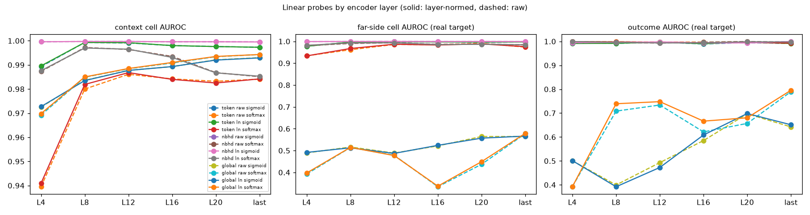

**Why the probe is decoupled from learning.** If any readout were trained on the model's predictions
or on outcomes, the readout itself could learn the blockade and we would be measuring the probe, not
the world model. So the probe is fitted once, on real context frames only, with ball positions from
the same frame, and is identical before and after post-training (rules in [CLAUDE.md](CLAUDE.md),
enforced bit-for-bit by `tests/test_eval_isolation.py`). All blockade knowledge has to come from
post-training.

## 3. Post-training V-JEPA 2 on the blockade

**How.** Encoder frozen; the predictor is trained to predict the target-half latents from the context
(L1 in layer-normalised latent space), 5-fold cross-validation (`cv_folds`, seed 0), on Kaggle.
Freezing the encoder keeps the probe valid and makes training cheap, at the cost of only reshaping
what the predictor does with features it already has.

**What is hard about it.** A plain latent loss averages over the possible futures. When a pass could
go either way the predictor hedges: the imagined ball fades into a blurry, low-probability smear, or
it picks the most common future ("blocked") for every pass. Before post-training the model almost
never imagines the ball past the plank at all.

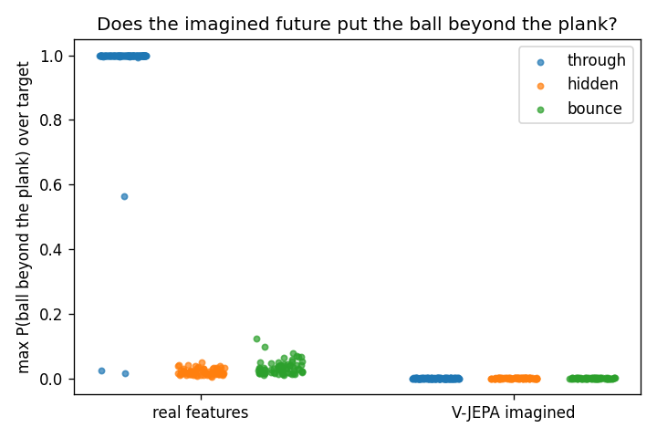

**What fixed it** (best run, `models/vjepa2/posttrain.py`):

- **commit loss:** the L1 is weighted towards moving tokens, with a contrast term, so the predictor
  commits to a visible ball rather than a blur.
- **Loss-weighted sampling:** each epoch, clips are drawn in proportion to their previous loss (no
  outcome labels), so hard passes near the blocker's edges get more training.
- **20 epochs, both directions** (run **C**), then **G** = C plus 5 epochs that add the open-table clips.
- **Multi-step rollouts** score the imagined future frame by frame, 1.5 s ahead.

Variants that did not help: a copy-last-frame gate (no change) and a multi-hypothesis head (collapsed
to "no ball").

**Results** (through vs blocked, from how much ball the imagined future puts past the plank):

| model | AUROC, ball from right | ball from left |
|---|---|---|
| real future frames through the probe (ceiling) | 0.998 | – |
| V-JEPA 2 pretrained | 0.42 | 0.66 |
| tracker + blockade fitted on outcomes (reference) | 0.85 | – |
| C (commit + loss-weighted, both sides, 20 epochs) | 0.961 | 0.893 |
| **G (C + 5 epochs with open-table clips)** | **0.971** | **0.873** |

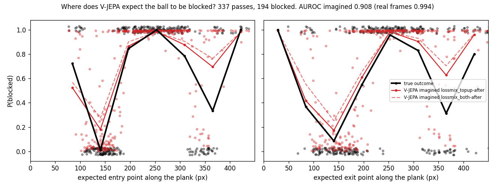
*Black: the true blocked rate along the plank. Red: G's imagined rate. Both through gaps are learnt.*

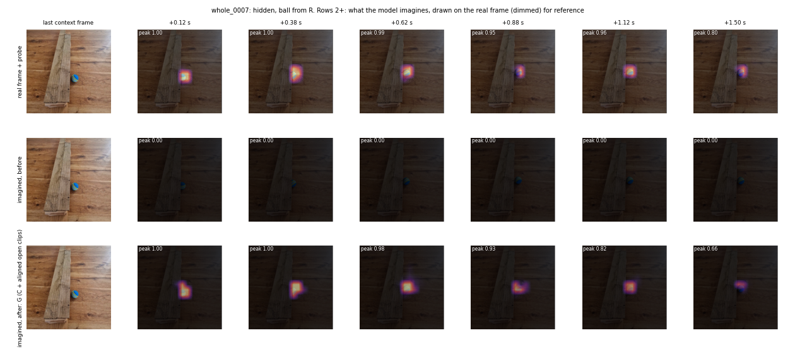
*A blocked pass: G keeps the ball under the plank instead of imagining it through.*

## 4. Robustness: the other side and the other ball

**The other side.** A model trained only on balls from the right gets *worse* on balls from the left
(0.64 to 0.36), and mirroring the clips doesn't rescue it. It learnt an image-space map ("at these
heights the ball ends up on the left") rather than "a solid object at a place". Training on both
directions at once fixes this: C and G score 0.89 / 0.87 on left-entry passes they never saw.

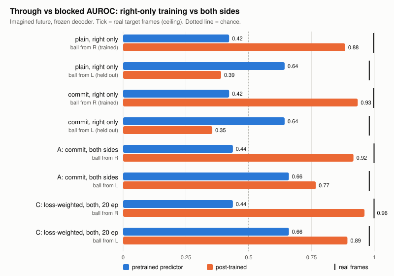

**The other ball (orange).** A held-out object test: score G, unchanged, on passes with an orange
ball it never saw in training. A model that learnt the scene should not care about the ball's colour.

> **Placeholder: orange-ball results pending** (run in progress). AUROC from right / left: _TBD_.

**Interpretability: a ball-colour direction.** The aim is to separate the latent direction that encodes
the ball's appearance (colour) from the parts that encode its position, speed and motion, so the world
model's scene knowledge (blockade, slope) can be shown to be independent of what the ball looks like.

> **Placeholder: colour-direction results pending.**

**Robustness so far.** The blockade transfers across entry directions once both are seen in training;
the object test above will show whether it also transfers across balls.

## 5. The table slope

The table tilts slightly downhill to the left. We measure it label-free on the imagined track:
**s = (downhill minus uphill acceleration) / 2** at matched speed, so friction cancels. Positions
come from the frozen probe, which itself reads only about half of the real pull from real frames, so a
model that has learnt the slope should land near the probe-on-real value.

| track | s (ball diameters / step²) | 95% range |
|---|---|---|
| real ball (tracker) | 0.025 | 0.021 to 0.031 |
| probe on real frames (target) | 0.014 | 0.006 to 0.025 |
| imagined, pretrained | – (ball never visible) | – |
| imagined, C | 0.019 | −0.018 to 0.051 |
| **imagined, G** | **0.024** | **−0.007 to 0.040** |

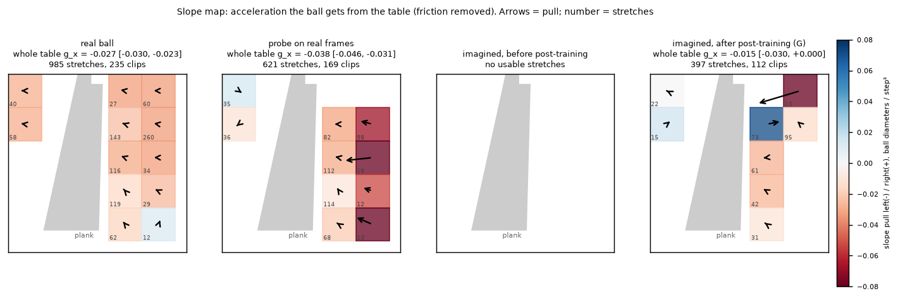

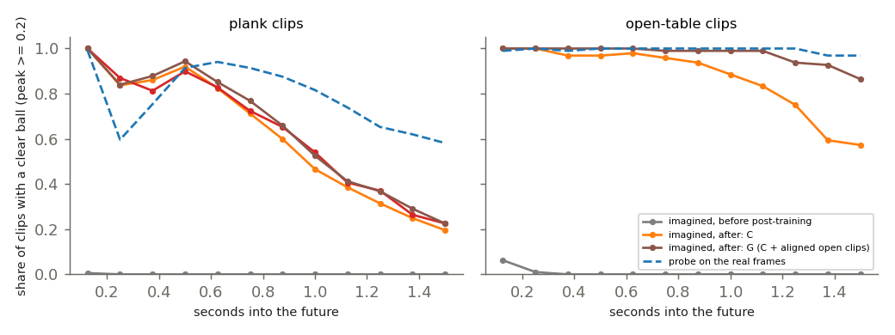
*Adding open-table clips (G) keeps the imagined ball visible on open table in 87% of clips at 1.5 s,
against 57% for C, which gives far more stretches to measure.*

**Reading.** G pulls the ball downhill at or above the probe's level: the slope is **likely learnt but
not proven**, because the range still just reaches 0. Proving it needs more open-table rolling or a
steeper tilt, i.e. more data.

## 6. From forecast to gripper policy

**How the forecast feeds the policy.** From G/C's imagined future, read through the frozen probe, we take
*whether*, *where*, *when* and *how fast* the ball comes out, and *how uncertain* that is. These few
numbers are the policy's only knowledge of the ball before it appears.

**Setting up the problem so the learning shows.** The gripper must commit before the ball is visible:
the fingers close at a limited speed (0.15 m/s) and open at most 9 cm for a 4 cm ball, so it cannot
simply react to every ball. Rewards: a pick-up earns +3 (more if early); a wasted trip for a blocked
ball costs −1; holding back on a blocked ball earns +0.5. A forecast that knows the blockade is worth
a lot; one that doesn't is not.

**Simulation and training.** PyBullet two-finger gripper (`models/gripper/`), trained with PPO from
scratch on CPU. A simple, fast physics sim was chosen over a heavy robotics stack because only the
grasp of one ball matters. The policy trains in simulation only, with forecasts that are the true
exit plus noise of a stated size, then is **frozen**. It never sees a world model's real forecasts
against real outcomes. A pretrained open-source policy was not used: none takes this forecast as
input, and training from scratch kept the comparison clean.

**Results** on all 335 real passes (141 come out, 194 blocked), mean reward per pass:

| forecast given to the frozen policy | sets off (comes out / blocked) | picks up | mean reward |
|---|---|---|---|
| none, or V-JEPA 2 before post-training | 100% / 100% | 43% | −0.08 |
| **post-trained (C)** | **72% / 4%** | 60% when it sets off | **+0.69** |
| perfect forecast (tracker) | 100% / 0% | 73% | +1.27 |

| blocked | uncertain, comes out | certain, comes out |
|---|---|---|
| [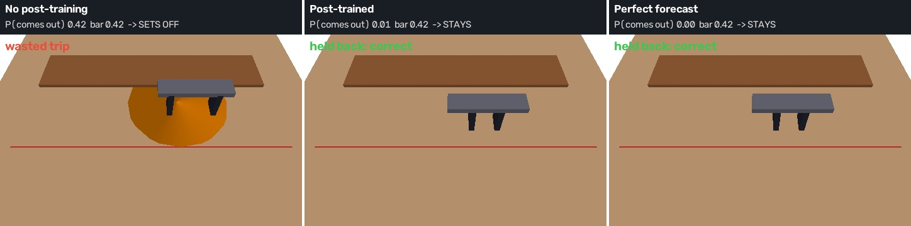](results/2026-10-04_2110_twoday/vjepa2/plan/gripper/pb_narrow_fs/page/vid/blocked.mp4) | [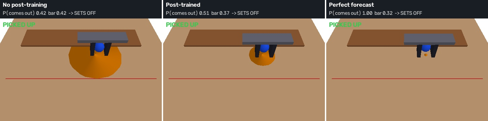](results/2026-10-04_2110_twoday/vjepa2/plan/gripper/pb_narrow_fs/page/vid/uncertain.mp4) | [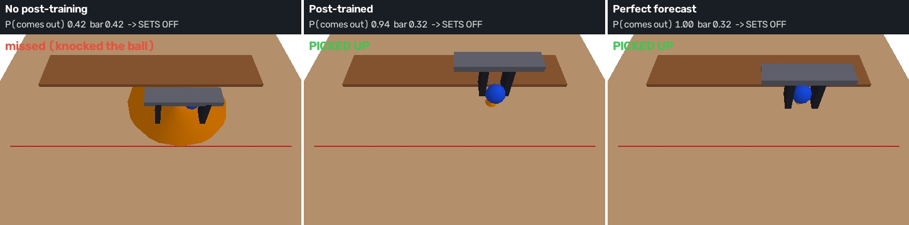](results/2026-10-04_2110_twoday/vjepa2/plan/gripper/pb_narrow_fs/page/vid/confident.mp4) |
| stays put | lines up, opens wider | lines up early, grips tight |

Interactive page: [Gripper Uncertainty Response](https://claude.ai/artifact/1pygtzGBW2LqB9bt6HPB9d).

**Applying it to any robot.** The policy only needs a small interface: *will it arrive, where, when,
how fast, how sure*. Any robot whose controller can be trained in simulation on that interface can
use a post-trained world model the same way, without retraining the world model.

## 7. Conclusion and impact

- Post-training V-JEPA 2 on a few hundred home clips teaches it an **invisible blockade** (AUROC 0.42 to
  0.97), measured through a probe that cannot have learnt it.
- It generalises across entry directions once both are seen, and **probably** learns the table slope.
- A frozen gripper policy turns that knowledge into behaviour: from −0.08 to **+0.69** reward per pass
  (perfect forecast +1.27), mostly by not chasing balls that will never arrive.

**Impact.** Homes are full of hidden state: a drawer that sticks, a step that isn't visible, objects
behind others. A humanoid that post-trains its world model on its own experience of one home can
learn such properties without labels and plan around them. **Handheld or head-mounted video** is the
natural data source; it adds camera motion, which latent-space models like V-JEPA 2 handle better than
pixel generators, but it would need camera-relative probes. The main implication: scene-specific
physics can be learnt from passive video alone, and the learning can be verified separately from the
readout.

## 8. How to run

**Clips.** Put the videos in `data/raw/videos/` and run `robustworld data/raw/videos/` (see
[docs/PIPELINE.md](docs/PIPELINE.md)). `scripts/cut_open_clips.py` cuts the open-table clips;
`scripts/pack_clips.py` zips the clips for Kaggle (the "DataBall" dataset).

**Post-training the best model (G) on Kaggle.** Open `notebooks/kaggle_plan.ipynb` (GPU T4 x2,
`GITHUB_TOKEN` secret attached), add the clips dataset, then Save & Run All. It runs
`models/vjepa2/plan.py`; to redo just the best runs:

```bash
python models/vjepa2/plan.py run --only lossmix_both-after --redo          # C, about 5.6 h
python models/vjepa2/plan.py run --only lossmix_topup-after --redo         # G = C + 5 epochs, needs C's weights
```

**Weights.** Fold weights (`fold0.pt` to `fold4.pt`) are too large for git. They are in the Kaggle
notebook outputs under `weights/lossmix_both-after/` (C) and `weights/lossmix_topup-after/` (G); add
that output (or a dataset named after the run, e.g. `lossmix-both-after`) as a notebook input and
`plan.py` finds it.

**Predicting with V-JEPA 2.** Score imagined futures through the frozen probe:

```bash
python models/vjepa2/ball_probe_cv.py --predictor-run <weights/lossmix_topup-after> \
    --manifest data/processed/clips/manifest_right.jsonl --out outputs/vjepa2/G
```

This writes `per_clip.json` (imagined ball per step, through-vs-blocked score) and the figures above.
Saved scores for the pretrained model, C and G are in `results/2026-10-04_2110_twoday/vjepa2/plan/scores/`.

**Gripper (CPU).** The approved policies are committed in `models/gripper/runs/pb_narrow_fs/`.

```bash
pip install pybullet gymnasium stable-baselines3
cd models/gripper
export GRIPPER_ENV=pybullet GRIPPER_PARAMS='{"GAP_MAX": 0.09, "FINGER_SPEED": 0.15}'
PLAN=../../results/2026-10-04_2110_twoday/vjepa2/plan
python blockade_eval.py --plan $PLAN --tag pb_narrow_fs --v2                       # the table in section 6
python videos.py --plan $PLAN --policy runs/pb_narrow_fs --tag pb_narrow_fs --gui  # watch it in PyBullet
```

See [models/gripper/README.md](models/gripper/README.md) for training (`train.py`) and
`results/.../gripper/pb_narrow_fs/` for the saved results.
