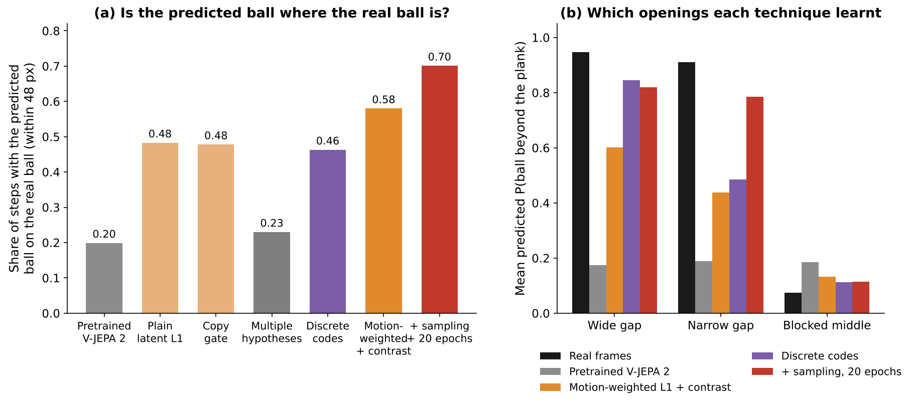
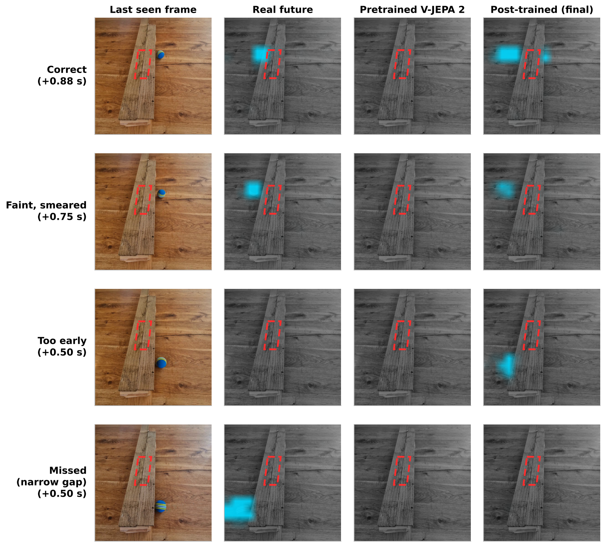
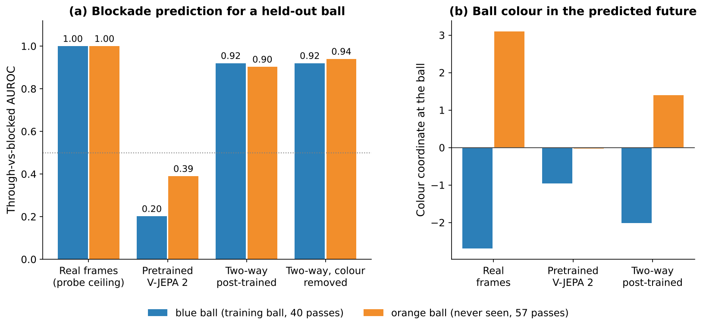

# RobustWorld: Learning Hidden Scene Physics from Home Video for Robot Control

## Abstract

Robots in homes must act on properties of a scene that cannot be seen. This work tests whether a pretrained video
world model can learn such a property **purely by self-supervised post-training on a small amount of home video**,
and whether a robot policy benefits.

A ball rolls under a plank; a hidden blocker stops some passes while others emerge, and the table is slightly
tilted. **The model is shown only the first 1.5 s of each pass, ending just before the plank, and must predict the
whole next 1.5 s in one pass with no further input** (no later frames, actions, labels or blocker information). The
V-JEPA 2 predictor is post-trained on 337 passes and read by a frozen linear probe that never sees outcomes or
predictions, so any blocker knowledge must lie in the world model. Through-vs-blocked AUROC rises from **0.44 to
0.97** in the training direction (0.66 to 0.87 from the other side; 0.39 to 0.90 for an unseen orange ball), and the
slope is likely, not conclusively, recovered. A simulated gripper that must commit before the ball reappears improves
from **−0.08 to +0.69** mean reward per pass (perfect forecast +1.27), chiefly by not chasing balls that never emerge.

**Key findings**

| question | answer | evidence |
|---|---|---|
| Can post-training on home video teach a hidden blocker? | Yes | AUROC 0.44 → 0.97 (training direction), above a tracker fitted on outcomes (0.85) |
| What made it work? | A loss that penalises hedging, hard-example sampling, a longer schedule, both entry directions | Section 3.2 |
| Does it generalise? | Yes: across entry directions once both are seen, and to an unseen orange ball (AUROC 0.90) | Section 4 |
| Is the table slope learnt? | Likely, not proven | s = 0.024 (95% CI −0.007 to 0.040) vs 0.014 attainable |
| Does a robot benefit? | Yes | Gripper reward −0.08 → +0.69 per pass (perfect forecast +1.27) |

<p align="center"></p>

*Figure 1. A pass that emerges. Left: real future, read by the probe. Centre: pretrained V-JEPA 2 loses the ball.
Right: the final model predicts it emerging. Cyan = probe's ball location (opacity = confidence); red dashed outline
= hidden blocker.*

## Contents

1. [Quick start](#quick-start)
2. [Problem statement and data](#1-problem-statement-and-data)
3. [Architecture and measurement](#2-architecture-and-measurement)
4. [Post-training V-JEPA 2](#3-post-training-v-jepa-2)
5. [Robustness](#4-robustness)
6. [The table slope](#5-the-table-slope)
7. [From forecast to gripper policy](#6-from-forecast-to-gripper-policy)
8. [Conclusion, impact and outlook](#7-conclusion-impact-and-outlook)
9. [How to run](#8-how-to-run)
10. [References](#references)

## Quick start

```bash
pip install -e .                                   # clip pipeline and evaluation tools
robustworld data/raw/videos/whole.mp4              # video -> tracked, labelled 3 s clips
python -m pytest tests/                            # includes the evaluation-isolation test
```

Post-training runs on Kaggle (2x T4) via `notebooks/kaggle_plan.ipynb`; the gripper runs on CPU. See
[How to run](#8-how-to-run).

| model name used throughout | definition |
|---|---|
| Pretrained V-JEPA 2 | ViT-L V-JEPA 2 as released, no post-training |
| Two-way post-trained model | predictor post-trained for 20 epochs on passes from both entry directions (motion-weighted loss with contrast, loss-weighted sampling) |
| **Final model** | the two-way post-trained model, fine-tuned for 5 further epochs with added open-table rolling clips |

## 1. Problem statement and data

### 1.1 Why this scene

Success here is unambiguous and checked automatically. The blocker is a **discrete, unobservable state**: no frame
shows it, yet every outcome is visible. The task needs **object permanence** (the ball persists while occluded) and a
**distribution over outcomes** (passes near the edges go either way), the regime in which deterministic fine-tuning
blurs futures together. The tilt adds a weaker, continuous effect.

The blocker leaves a **wide gap** (about 82 px, 104–186 px along the plank) and a **narrow gap** (about 52 px,
315–367 px); the narrow gap is harder throughout, with fewer passes and edges close to the blocker.

### 1.2 Data collection and processing

One fixed overhead phone recording of a hand-rolled ball, from both sides of the plank, with the blocker unmoved
(fitted extent 178–320 px in the first 14 minutes, 194–325 px in the last). It yields **254 passes from the right**
(111 through, 77 hidden, 66 bounce; the training direction), **83 from the left** (32 through, 48 bounce, 3 hidden)
and open-table clips. An **orange ball** filmed from another angle (57 passes) is held out as an unseen-object test.

The pipeline (`src/robust_world/pipeline.py`, [docs/PIPELINE.md](docs/PIPELINE.md)) needs no manual labels: a
colour tracker finds the ball and a hand detector drops clips where a hand touches it. Each approach becomes a 3 s
clip (48 frames, 16 fps, 512x512) whose first half, the *context*, ends just before the plank; the second half, the
*target*, is to be predicted. Outcomes (*through*, *bounce*, *hidden*) follow from fixed rules on the track and are
used for scoring only.

<p align="center"></p>

*Figure 2. Sample clips: the three outcomes from the training direction, a pass from the opposite direction, and
stills of the held-out orange ball. The red dashed outline marks the hidden blocker.*

<p align="center"></p>

*Figure 3. The three outcomes on the last context frame. White: observed track (circle = start). Yellow: target
track (dashed when the ball is never seen again). Red dashed outline: hidden blocker. "Bounce" and "hidden" are both
blocked.*

## 2. Architecture and measurement

### 2.1 Why a latent world model rather than a generative video model

Three generative video models, Wan 2.1 [1], Cosmos and LTX-Video (runners in `models/`), were evaluated
zero-shot. Pixel generation spends capacity on texture and lighting; outputs were often blurry or implausible and had
to be re-tracked before scoring. Zero-shot they also showed the ball continuing along or under the plank, the same
error as the pretrained V-JEPA 2, so they too would need post-training, but billion-parameter diffusion models are
expensive to adapt on a few hundred clips, prone to overfitting, and too slow for a control loop.

V-JEPA 2 [2] predicts in a learned latent space (Joint-Embedding Predictive Architecture), which abstracts away
unpredictable pixel detail; its predictor can be post-trained alone with the encoder frozen, and one forward pass
gives the forecast. It already supports zero-shot robot planning [2], such pretraining yields intuitive-physics
understanding [3], and predictive world models are argued to underpin autonomous agents [4]. The cost is no
viewable frames: predictions are only as legible as their readout (Section 2.3).

### 2.2 Architecture and what is trained

Each 1.5 s half-clip is resized to 256x256 and split into 2x16x16 tubelets, giving a 12x16x16 grid of $N = 3072$
tokens per half.

- **Encoder** $E_\theta$: ViT-L (24 layers, width 1024, about 300 M parameters). It maps the context frames to tokens
  $z_c = E_\theta(x_{1:24}) \in \mathbb{R}^{N \times 1024}$, encoded on their own so that nothing leaks from the
  future. **Frozen throughout.**
- **Predictor** $P_\phi$: a narrower transformer (12 layers, width 384). A linear map projects $z_c$ to width 384,
  learned mask tokens with positional embeddings mark the target positions, and a linear map projects the outputs
  back to 1024, giving the predicted target tokens $\hat z_t = P_\phi(z_c) \in \mathbb{R}^{N \times 1024}$.
  **All predictor weights $\phi$ are updated**: input and output projections, mask tokens and every transformer block.

Post-training is thus a full update of the predictor, not an added head, with $E_\theta$ fixed. The target is
$\bar z_t = \mathrm{LN}(z_t)$, the layer-normalised encoding of the real target half, as in V-JEPA 2; $\mathrm{LN}$
rescales each token's 1024 features to zero mean and unit variance so every token counts equally.

**What is standard and what is new.** The architecture, frozen encoder, LN latent target and plain L1 are V-JEPA
2's design [2]. This work adds three elements: motion weighting $w_i$, a contrastive InfoNCE term (from Contrastive
Predictive Coding [5]) and loss-weighted sampling. JEPA pretraining avoids contrastive losses, but with the encoder
frozen the target space cannot collapse, so the term is safe here.

**Objective.** The final configuration minimises a motion-weighted latent L1 loss plus a contrastive term:

$$
\mathcal{L}(\phi) = \underbrace{\frac{\sum_i w_i \,\lVert \hat z_{t,i} - \bar z_{t,i} \rVert_1}{D \sum_i w_i}}_{\text{motion-weighted L1}}
\;+\; \lambda \underbrace{\left(-\log \frac{\exp(-d(\hat z_t, \bar z_t)/\tau)}{\sum_{c \in \mathcal{C}} \exp(-d(\hat z_t, \bar z_c)/\tau)}\right)}_{\text{InfoNCE over other clips' futures}}
$$

$$
w_i = 1 + \alpha\, \frac{m_i}{\overline{m}}, \qquad m_i = \max\big(\lVert \Delta \bar z_{t,i} \rVert_1,\ \lVert \Delta \hat z_{t,i} \rVert_1\big)\ \text{(no gradient)}
$$

Here $i$ indexes tokens, $D = 1024$, $\Delta$ is the change from the previous time step, $\overline{m}$ is the mean
of $m$ over the clip, and $d$ is the same weighted L1 distance. The candidate set $\mathcal{C}$ holds the clip's own
real future, the other clips in the batch and 8 stored futures of other training clips. Settings: $\alpha = 4$,
$\lambda = 0.1$, $\tau = 0.02$; AdamW with learning rate $3 \times 10^{-5}$ and weight decay 0.04; effective batch 8
(2 clips x 4 accumulation steps); cosine schedule with 10% warm-up; fp16 with gradient checkpointing on a T4. Clips
are drawn each epoch with probability $p_k \propto \max(\ell_k, 0.25\,\bar\ell)$, where $\ell_k$ is clip $k$'s loss
in the previous epoch. The open-table fine-tune continues from these weights with the same loss for 5 epochs.

**Why each term.** The ball covers about 1.5% of tokens, so an unweighted loss can ignore it; the *weights* fix
this, and taking the maximum of real and predicted change makes a missed and a phantom ball equally costly (with no
gradient through the weights, they cannot be gamed). The *contrastive term* counters averaging: a blend of "through"
and "hidden" is equally far from both and cannot pick out its own clip, so InfoNCE rewards committing to one future.

### 2.3 A probe that cannot learn the blockade

The ball is read from any tokens, real or predicted, by a linear probe (`models/vjepa2/eval_decoder.py`):

$$
P(\text{ball in cell } j) = \sigma\big(w^\top \mathrm{LN}(z_j) + b\big), \qquad w \in \mathbb{R}^{1024}
$$

It is fitted once by logistic regression on **real context-half tokens only**, labelled with the tracker's ball
position (cell AUROC ≈ 1.00; median error 14–20 px of 512). A pass's through-vs-blocked score is the peak
probability over the 12 predicted steps that the ball is beyond the plank; on real future frames it reaches 0.998.

A readout trained on predictions or outcomes could learn the blocker itself. This is ruled out because the probe
(i) never sees outcomes, target halves or predictions, and so never a ball under or beyond the plank; (ii) is linear;
(iii) is identical for every model, so all differences come from the predictor; (iv) is built by a function
(`examples_from`) that accepts only context encodings and same-frame labels; and (v) is checked by
`tests/test_eval_isolation.py` to stay **bit-for-bit identical** when outcomes, target labels or predictions are
scrambled. Outcomes are used only to score.

## 3. Post-training V-JEPA 2

### 3.1 The core difficulty: multi-modal futures

A regression loss is minimised by the *mean* future, so where a pass could go either way the cheapest prediction
is a faint ball or none. The pretrained model is the extreme case, predicting "blocked" for almost every pass (Figure
1, centre). Each technique below targets this hedging.

### 3.2 Techniques evaluated

All variants used identical folds, data and budget (10 epochs, right-entry) and the same probe.

<p align="center"></p>

*Figure 4. (a) Through-vs-blocked AUROC for each objective after 10 epochs on the right-entry set (pretrained: 0.42
on this set; dotted line = chance). (b) Effect of the training schedule on the best objective. (c) Learning curve of
the two-way model, scored at saved epochs on both entry directions.*

| technique | AUROC | outcome | reason |
|---|---|---|---|
| Plain latent L1 (V-JEPA 2's objective) | 0.88 | baseline | learns the blockade, but by small ranking shifts; still hedges |
| **Motion-weighted L1 + contrast** | **0.93** | **kept** | first clearly visible predicted balls beyond the plank |
| Discrete codes (k-means grouping of tokens) | 0.91 | not kept | sharp in the wide gap, poor in the narrow gap |
| Copy-last-frame gate | 0.89 | no effect | background was not the bottleneck |
| Multiple hypotheses, winner-takes-all | 0.42 | failed | collapsed onto one "no ball" future |
| Autoregressive rollout | 0.415 (pretrained) | not kept | no gain at baseline; much higher training cost |
| **Loss-weighted sampling** | **0.95** | **kept** | more updates on rare, hard passes |
| **20-epoch schedule** | **0.96** | **kept** | narrow gap learnt; largest single gain |
| **Both entry directions** | 0.96 / 0.89 | **kept** | needed to transfer across directions (Section 4.1) |
| **Open-table fine-tune** | 0.97 / 0.87 | **kept** | keeps the ball visible for slope measurement |

**Plain latent L1.** V-JEPA 2's own loss already reaches 0.88, so the predictor can absorb the blockade, but only
by small ranking shifts: P(blocked) stays near 1 because the loss still rewards hedging.

**Motion-weighted L1 with contrast.** Gave the first clearly visible balls beyond the plank and the best 10-epoch
score, though only the wide gap was learnt.

**Discrete codes.** Classifying each token into one of 256 k-means codes forces "ball" or "no ball". Sharpest in the
wide gap (0.85 vs 0.95 real probability of a ball beyond the plank) but poor in the narrow gap (0.49 vs 0.91): the
codebook discards the detail of a partly visible ball.

**Copy gate.** A per-token gate copying the last context frame changed nothing (0.885 vs 0.884): the background was
not the bottleneck.

**Multiple hypotheses.** Several futures with a learned picker collapsed onto one "no ball" future; winner-takes-all
needs careful balancing, and 254 clips gave too little signal.

**Autoregressive rollout.** No gain on the pretrained predictor (0.415 vs 0.422) at many times the training cost, so
one-pass prediction was kept.

**Loss-weighted sampling and a longer schedule.** Sampling by previous-epoch loss focuses on hard passes near the
edges without labels. At 20 epochs the narrow-gap ball probability rose from 0.44 to 0.79 (real 0.91), plateauing
around epoch 15 (Figure 4c).

**Both directions and the open-table fine-tune.** Both directions were needed for transfer (Section 4.1) at no cost
on the right (0.961 vs 0.964). Five open-table epochs keep the ball visible in 87% of clips at 1.5 s (57% before),
making the slope measurable, with blockade scores unchanged within intervals.

**How each technique fails.** Figure 5 compares the techniques on two label-free measures. The pretrained model and
the multiple-hypotheses head place the ball correctly on only about a fifth of steps, because they rarely predict a
ball beyond the plank. Plain L1 and the copy gate roughly double this but leave the ball faint. Discrete codes give
the strongest ball in the wide gap but about half the real level in the narrow gap. The motion-weighted loss with
contrast places the ball most often, and only sampling plus the longer schedule lift the narrow gap near the wide one.

<p align="center"></p>

*Figure 5. (a) Share of predicted steps in which the probe's most likely ball cell lies within 48 px of the real
ball (right-entry passes, 10-epoch variants except the last). (b) Mean predicted probability of a ball beyond the
plank for passes reaching each region, against the real frames; no outcome label enters either measure.*

> **Summary of what worked.** The gains came from *how the predictor is trained*: a loss that makes hedging costly,
> hard-pass sampling and, largest of all, a longer schedule. Architectural additions did not help, targeting an
> absent bottleneck or needing more than 254 clips.

### 3.3 Results

<p align="center"></p>

*Figure 6. Through-vs-blocked AUROC on held-out folds (95% bootstrap intervals; dotted = chance). (a) All 337
passes (tracker reference: 254 right-entry passes, blocker fitted on outcomes). (b) By entry direction.*

| model | AUROC, all passes | from the right | from the left |
|---|---|---|---|
| Real future frames through the probe (ceiling) | 0.998 | – | – |
| Pretrained V-JEPA 2 | 0.45 | 0.44 | 0.66 |
| Point tracker + straight line, no blocker (reference) | – | 0.54 | – |
| Point tracker + blocker fitted on outcomes (reference) | – | 0.85 | – |
| Two-way post-trained model | 0.91 | 0.96 | 0.89 |
| **Final model** | **0.93** | **0.97** | **0.87** |

**Comparison with a tracker that is given the blocker.** The TAPNext point tracker (BootsTAPNext,
`models/tapnext_rule/`) follows five points on the ball through the context and extends its path in a straight line.
With no blocker it predicts every ball emerging (0.54). Adding a rule that stops the ball if the line crosses a
blocker range fitted on each fold's training outcomes (about 183–332 px on every fold) raises it to 0.85, still well
below the post-trained models (0.96–0.97): a straight line misses balls that curve or slow near the edges (41
blocked passes predicted through), and the rule cannot tell a bounce from a stop. The world model learns these
dynamics without being told where the blocker is.

A paired bootstrap of the gain over the pretrained model on the same clips excludes zero for every successful run, and
the left-side difference between the two-way and final models (−0.02) is well inside its interval.

<p align="center"></p>

*Figure 7. Probability that a pass is blocked, binned by where the ball reaches the plank (all 337 passes; mean and
95% bootstrap interval per bin). The pretrained model predicts "blocked" everywhere; the final model recovers both
gaps.*

**The narrow gap is learnt less well.** Mean predicted P(blocked) falls to 0.25 in the wide gap but only 0.57 in
the narrow gap (real rate 0.11 in both). The narrow gap has a third as many passes (33 through vs 106), is 37%
narrower, so small crossing errors land on the blocker, and its edges are genuinely ambiguous.

<p align="center"></p>

*Figure 8. A blocked pass, predicted 0.25–1.5 s ahead: the final model holds the ball at the plank, as in reality.
Prediction panels are drawn on the empty scene.*

**Where the predictions still fall short.** Figure 9 shows a correct forecast and the final model's three typical
errors (the pretrained model shows no ball in each): a *faint, smeared* ball where the outcome is uncertain; a *too
early* exit, since timing through the occlusion is less constrained than direction; and a *missed* narrow-gap pass.

**How the remaining errors could be resolved.** More passes, especially through the narrow gap, would help all
three. Beyond that, *faint* forecasts could become two sharp alternatives with a stochastic predictor (a latent noise
input with a balanced best-of-$k$ loss); *early* forecasts could be tightened by weighting the steps where the ball
reappears or by a longer context; and *missed* narrow-gap passes could be reduced by stronger loss-weighted
sampling and time-shifted copies of existing narrow-gap clips.

<p align="center"></p>

*Figure 9. Correct and incorrect forecasts of emerging passes, at the clearest step. Columns: last observed frame,
real future, pretrained V-JEPA 2, final model. Cyan = probe's ball; red dashed = hidden blocker.*

> **Summary.** The final model nearly matches the real future through the same probe (0.97 vs 0.998) and beats a
> tracker fitted on outcomes; the narrow gap remains its weakness.

## 4. Robustness

### 4.1 The opposite entry direction

Post-training on right-entry passes only makes left-entry passes *worse* (0.64 to 0.36), even with mirroring: the
model learns an image-space outcome map ("at these heights the ball ends up on the left"), which is inverted for
balls from the left. Training on both directions fixes this (0.89 two-way, 0.87 final) with no loss on the right.
Only 6 left-entry passes reach the narrow gap.

### 4.2 A held-out object: the orange ball

The two-way model, unchanged, is scored on 57 passes of a pale orange ping-pong ball never seen in training, filmed
from another angle (27 through, 30 blocked). It reaches AUROC **0.90**, against 0.92 on 40 matched blue passes and
0.39 for the pretrained model (Figure 10a). The final model was not scored on this set.

### 4.3 Interpretability: isolating ball appearance

Does the forecast depend on the ball's appearance, or only on where it is and how it moves? This was tested by
finding the colour direction in the frozen encoder's feature space and removing it.

**Finding the direction.** The colour direction is the normalised difference of the two balls' mean LN tokens at the
ball's cells in real context frames,

$$
d = \frac{\mu_{\text{orange}} - \mu_{\text{blue}}}{\lVert \mu_{\text{orange}} - \mu_{\text{blue}} \rVert},
\qquad \mu_b = \frac{1}{\lvert \mathcal{B}_b \rvert} \sum_{j \in \mathcal{B}_b} \mathrm{LN}(z_j)
$$

where $\mathcal{B}_b$ is the set of ball-cell tokens of ball $b$ in real context frames. Its only label is which
ball is in the video (no outcomes, targets or predictions), and with the encoder frozen it is the same for every
model. Being a difference of means, it captures nothing beyond the average difference between the balls.

**Checking that it is colour and nothing else.** Fitted on four folds and tested on the fifth, the projection
$d^\top \mathrm{LN}(z)$ separates the balls at AUROC 0.997, and its cosine with the probe's position readout $w$ is
−0.04. Within each ball it is only weakly related to position and speed for blue, with $|r| \le 0.27$, but moderately to
speed for orange, with $r = 0.54$, plausibly because of the different camera angle.

**Removing it.** Before the predictor runs, each context token's coordinate along $d$ is set to the blue-ball mean,
$z \leftarrow z - \big(d^\top z - \bar c_{\text{blue}}\big)\,d$, and the unchanged probe scores the two-way model's
forecasts.

**Results.** Removing colour *raises* orange-ball AUROC from 0.90 to **0.94** and leaves blue unchanged (0.92), so
the blockade knowledge does not need the ball's colour. The cost is bounce-vs-stop on the orange ball, which drops
from 0.86 to 0.52, so some of that information travels with the colour axis. The post-trained model also keeps the
predicted ball partly orange, whereas the pretrained model loses it (Figure 10b), suggesting that post-training
preserves object identity through the occlusion.

<p align="center"></p>

*Figure 10. (a) Through-vs-blocked AUROC for the training (blue) and held-out (orange) ball; "colour removed" sets the
colour coordinate to the blue level before the predictor (dotted line = chance). (b) Colour coordinate at the ball's
position, read from real frames and from each model's predicted future (positive = orange).*

Caveats: this probe was fitted on 100 blue clips, and no confidence intervals have yet been computed. The cheapest
next check is the reverse swap on blue clips.

> **Summary.** The blockade transfers across directions once both are seen, and to an unseen ball from a new angle
> (0.90 vs 0.92); removing colour does not harm it, so the property belongs to the scene, not the training ball.

## 5. The table slope

The table slopes slightly downhill to the left. The slope is measured label-free on each predicted track as

$$
s = \tfrac{1}{2}\left(a_{\text{downhill}} - a_{\text{uphill}}\right)
$$

where $a$ is acceleration along the motion, compared at matched speeds so friction cancels (units: ball diameters
per step², step = 1/8 s). Even on real frames the probe recovers about half the real pull (0.014 vs 0.025), so models
should be compared with the probe-on-real value.

<p align="center"></p>

*Figure 11. Left-right acceleration after removing friction (red = downhill, to the left; arrows = pull), smoothed
with the same Gaussian kernel (σ = 130 px); sparse regions blank. The pretrained model never shows the ball on open
table, so it is omitted.*

| track | s (ball diameters / step²) | 95% interval |
|---|---|---|
| Real ball (tracker) | 0.025 | 0.021 to 0.031 |
| Probe on real frames (attainable value) | 0.014 | 0.006 to 0.025 |
| Two-way post-trained model | 0.019 | −0.018 to 0.051 |
| **Final model** | **0.024** | **−0.007 to 0.040** |

> **Summary.** The final model pulls the ball downhill at or above the attainable level over most of the table, but
> the upper right shows little pull and the interval includes zero: **likely learnt, not proven**. More open-table
> rolling or a steeper tilt is needed; the limit is data, not the model.

## 6. From forecast to gripper policy

### 6.1 Interface between world model and policy

**What the gripper knows, and when.** When the context half ends, the world model makes **one** forecast from the
1.5 s it has seen; that is all the gripper is told about the future, and nothing is updated afterwards. The gripper
must decide whether to set off and where to wait while the ball is hidden. It sees the ball itself only once it
emerges (two frames late), usually too late to start moving; a blocked ball never appears, so only the forecast can
prevent a wasted trip.

The forecast, read through the frozen probe, gives **whether** the ball emerges, $p$, **where**, **when**, **how
fast** and **how uncertain**: $u \in [0, 1]$, from how spread or weak the predicted ball is, with standard deviations
$\sigma_s = 0.12u$ m, $\sigma_t = 0.3u$ s and $\sigma_v = 0.5u\,\lvert v \rvert$; $u = 1$ means no information.

### 6.2 Problem design

The fingers close at most 0.15 m/s and open at most 9 cm for a 4 cm ball, so the gripper cannot simply react once
the ball appears. A wider, faster gripper was tried first and could react, making even a good forecast worthless.

### 6.3 Simulation and policy training

**Simulator.** The gripper is simulated in PyBullet (`models/gripper/`). The question is whether the forecast
changes behaviour, so the simulator only needs a rolling ball, two fingers and contact that tells a held ball from a
dropped one; PyBullet gives this from one pip install on a laptop CPU, with a viewer. MuJoCo's more accurate contact
and GPU training would not change the answer here, so the simpler tool avoids over-engineering a part not under test. Each episode replays a
real exit (tracker position, time and velocity, lightly jittered).

**What the policy learns.** Every 1/16 s it outputs four numbers in $[-1, 1]$: velocity along and towards the
plank, finger opening and a close trigger, i.e. **where to wait**, **when to move**, **how wide to open** and **when
to close**. Its observation $o_t \in \mathbb{R}^{17}$ holds the forecast and its uncertainty, the gripper's state and,
once visible, a fit of the ball's position and velocity.

**Reward and training.** Each episode scores
$r = 1 + 0.5\,(1 - \delta) - 0.3\,g - c_{\text{move}}$ if the ball is lifted and held, and
$r = -1 - c_{\text{move}}$ otherwise, where $\delta$ is how late the grasp happened, $g$ how wide the fingers were
open and $c_{\text{move}}$ a small travel cost. A two-layer MLP (128 units) is trained with standard PPO [6]
(Stable-Baselines3, small entropy bonus; 2.5 M steps per fold, 5 folds). In training, each episode draws
$u \sim \mathcal{U}(0, 1)$ and a forecast $\hat x = x + \varepsilon$, $\varepsilon \sim \mathcal{N}(0, (0.12u)^2)$ m
(likewise for timing and speed), so the policy learns how far to trust a stated uncertainty. It is then **frozen**
and driven by each world model's real forecast, so one policy serves every model.

**Decision to set off.** The gripper sets off when the expected reward of going exceeds that of staying. Going is
worth $p$ times the reward of an attempt at the simulated success rate $c(u)$, minus $1 - p$ times the cost of a wasted
trip. Nothing in the rule is fitted to real data.

### 6.4 How uncertainty drives behaviour

<p align="center"></p>

*Figure 12. Top: the frame before the ball appears, for four forecasts; the orange disc, of radius $\sigma_s$, is the
forecast exit region (hidden by the fingers below about 2 cm). Bottom: simulated pick-up rate $c(u)$ against
uncertainty.*

The pretrained forecast carries no information: $u = 1$, a 12 cm region and 42% pick-up in simulation. The post-trained
model's region is 6 cm on an uncertain pass and under 2 cm on a confident one, approaching the 71% of a perfect
forecast.

### 6.5 Results

Mean reward per pass over all 335 real passes (141 emerge, 194 blocked):

| forecast given to the frozen policy | sets off (emerges / blocked) | picks up | mean reward |
|---|---|---|---|
| none, or pretrained V-JEPA 2 | 100% / 100% | 43% | −0.08 |
| **two-way post-trained model** | **72% / 4%** | 60% of attempts | **+0.69** |
| perfect forecast (tracker) | 100% / 0% | 73% | +1.27 |

| | no post-training | post-trained | perfect forecast |
|---|---|---|---|
| **Blocked pass** |  |  |  |
| **Emerges, uncertain forecast** |  |  |  |
| **Emerges, confident forecast** |  |  |  |

*Figure 13. The same frozen policy driven by three forecast sources on three real passes (headers: P(comes out),
threshold, decision). Without post-training it sets off for every ball; with it, it holds back on the blocked pass.*

> **Summary.** The post-trained forecast closes most of the gap to perfect information (+0.69 of +1.27, from −0.08),
> mainly by *not* setting off for blocked balls (4% wasted trips instead of 100%). The remaining gap is mostly
> narrow-gap passes predicted blocked.

### 6.6 What transfers to other robots, and what does not

**The scene model transfers to any robot with the same viewpoint.** The predictor, the probe and the forecast
interface contain nothing gripper-specific. **Its coordinates transfer with calibration:** positions are in image
pixels, so another robot needs the camera-to-robot transform (and a moving camera a world-fixed readout). **The
low-level policy does not transfer:** it is tied to this gripper's actions, limits, observations, reward and
catch-rate curve $c(u)$, but it is the cheapest part to replace because it is trained in simulation.

**Further directions (not yet tested).**

- *Generalist policy.* Octo [7] can be fine-tuned to new inputs and action spaces with a small tokenizer and head;
  the forecast would enter as one extra observation token, trained on simulated demonstrations from the PPO policy.
- *Retargeting.* The forecast is in scene coordinates, so a grasp target (where and when to close) can be mapped
  through each robot's own kinematics; only the low-level controller differs.
- *A neutral shared policy.* One end-effector-space policy on the same forecast, with thin per-robot adapters, would
  give every robot a common baseline, provided the data are presented identically (same forecast vector, frames and
  units).

### 6.7 Towards language-selected behaviour

A natural extension is a multi-skill policy in which a language instruction ("be careful", "be quick", "let it roll
past") selects *how* the robot acts on the same forecast. This has not been built, but the set-off rule of Section
6.3 already provides the hook: its weights on a pick-up, a wasted trip and a ball let go are a *risk attitude*, and
changing them changes behaviour without retraining the policy or the world model.

Re-applying the rule to the two-way model's saved forecasts for all 335 real passes gives the estimates below.
Unchanged decisions keep their simulated outcome, and new set-offs are scored with the simulated rate $c(u)$.

| attitude (wasted-trip cost / letting-go cost) | sets off, ball emerges | sets off, ball blocked | pick-ups per 100 passes | mean reward |
|---|---|---|---|---|
| cautious (2 / 0.5) | 67% | 4% | 17.6 | +0.67 |
| default (1 / 1) | 72% | 4% | 18.2 | +0.69 |
| hasty (0.3 / 2) | 76% | 6% | 19.0 | +0.72 |
| always go, no forecast used | 100% | 100% | 23.6 | +0.13 |

A cautious robot wastes almost no trips but lets more balls go; a hasty one catches slightly more at the cost of a
few wasted trips. The effect is modest because the forecast is usually confident; with a less certain world model
the same instruction would move behaviour further. Language could also act on the uncertainty itself ("assume you
might be wrong" inflating $u$ before the policy sees it). A vision-language-action model would map instructions to these few parameters, or to
a skill embedding learnt from simulated demonstrations, so that "fairly careful" interpolates between styles.

**Why set risk through language.** The right level of risk depends on context the world model cannot observe:
fragility, nearby people, whether speed or reliability matters. Exposing it as one explicit parameter means that
*it transfers across contexts and tasks without retraining*, since "careful" means the same for catching, pouring or
opening a door; *it separates belief from preference*, so a better world model improves every attitude and a change of
attitude never corrupts the forecast; and *it is cheap and auditable to supervise*, since "too hesitant" maps to a
visible number rather than new demonstrations. The same pattern fits any learnt predictor that feeds a decision,
such as driving assistance with a user-chosen caution.

**Implications for humanoids.** For a humanoid in a home, reaching for something absent costs time and can be unsafe
near people, while hesitating can fail the task. Keeping forecast, uncertainty and attitude separate lets safety
limits act on the attitude directly (held to "cautious" near a child), lets one forecast serve every skill and body,
and keeps behaviour explainable: the robot can say whether it held back because the ball looked blocked, because it
was unsure, or because it was told to be careful.

## 7. Conclusion, impact and outlook

### 7.1 Conclusion

Self-supervised post-training of V-JEPA 2 on a few hundred home clips teaches it an invisible blockade (AUROC 0.44
to 0.97), measured through a readout that cannot have learnt it. A loss that penalises hedging, loss-weighted
sampling, a longer schedule and both entry directions were decisive. The knowledge transfers across directions and
to an unseen orange ball (0.90), independently of colour; the narrow gap is weakest and the slope likely recovered. A
frozen gripper policy turns the forecast into reward (−0.08 to +0.69 per pass; perfect +1.27).

### 7.2 Impact and applications

Homes hold hidden, persistent state: a sticking drawer, an object behind another, an uneven floor. A robot that
post-trains its world model on its own observations can learn such properties without labels. As world models become
the predictive layer of robot systems [2, 4], this work offers a verifiable test that scene-specific physics can be
learnt from passive video and measured independently of the readout, with one forward pass per forecast suiting
power-limited humanoid hardware.

### 7.3 Updating the world model while the robot operates

Every pass labels itself (first half input, second half target), so the world model can keep learning during
operation: buffer recent clips, update the predictor between tasks at a small learning rate, and replay older clips
to avoid forgetting. The frozen encoder and probe keep the policy's input meaningful across updates. This is cheap
for a JEPA: only the small predictor is updated, against one encoder pass of the real future, with no pixel
reconstruction or diffusion steps; here an update cost under one second per clip on a T4. A moved-blocker recording
would test how quickly it adapts.

### 7.4 Would a JEPA remain the choice with more compute?

For the forecasting layer, yes: latent prediction suits multi-modal outcomes, runs cheaply on a robot and plugs into
planning [2]. More compute would go to unfreezing upper encoder layers (with the probe re-fitted first) and to the
action-conditioned predictor. Generative models remain useful for human-viewable predictions and synthetic training
scenes, so a likely system pairs a latent model for control with a generative one for visualisation and data.

### 7.5 Handheld and egocentric video

Human-held cameras are the scalable source of home video. Latent models absorb camera motion better than pixel
generators, but the probe and slope measurement would need a stabilised or world-fixed frame.

### 7.6 Limitations and next steps

One scene, one blocker position and one seed (5-fold cross-validation); only 3 hidden left-entry passes; a faint
narrow-gap ball; a slope interval including zero; and a gripper evaluated in simulation on real trajectories. Next:
a moved-blocker recording, the orange-ball test with intervals and the final model, an Octo fine-tune (Section 6.6),
and hardware.

## 8. How to run

### 8.1 Clips

Place the videos in `data/raw/videos/` and run `robustworld data/raw/videos/` (see [docs/PIPELINE.md](docs/PIPELINE.md)).
`scripts/cut_open_clips.py` cuts the open-table clips and `scripts/pack_clips.py` packages the clips for Kaggle.

### 8.2 Post-training the final model on Kaggle

Open `notebooks/kaggle_plan.ipynb` (GPU 2x T4; attach the `GITHUB_TOKEN` secret and the clips dataset) and Save &
Run All. The notebook runs `models/vjepa2/plan.py`; to repeat only the best runs:

```bash
python models/vjepa2/plan.py run --only lossmix_both-after --redo     # two-way post-trained model (~5.6 h)
python models/vjepa2/plan.py run --only lossmix_topup-after --redo    # final model: + 5 epochs open table
```

### 8.3 Weights

Fold weights (`fold0.pt`–`fold4.pt`) exceed GitHub's file limits and are kept in the Kaggle notebook outputs:
`weights/lossmix_both-after/` (two-way model) and `weights/lossmix_topup-after/` (final model). Attach that output,
or a Kaggle dataset named after the run (e.g. `lossmix-both-after`), as a notebook input; `plan.py` locates it.

### 8.4 Predicting with V-JEPA 2

```bash
python models/vjepa2/ball_probe_cv.py --predictor-run <path>/weights/lossmix_topup-after \
    --manifest data/processed/clips/manifest_right.jsonl --out outputs/vjepa2/final
```

This writes `per_clip.json` (predicted ball position and visibility per step, and the through-vs-blocked score) and
`maps.npz` (probe maps per step). Saved scores for the pretrained, two-way and final models are in
`results/2026-10-04_2110_twoday/vjepa2/plan/scores/` (`both-before`, `lossmix_both-after`, `lossmix_topup-after`).
`python docs/figures/make_figures.py --clips data/processed/clips/whole` redraws every figure in this README.

### 8.5 Gripper (CPU)

The trained policies are committed in `models/gripper/runs/pb_narrow_fs/`.

```bash
pip install pybullet gymnasium stable-baselines3
cd models/gripper
export GRIPPER_ENV=pybullet GRIPPER_PARAMS='{"GAP_MAX": 0.09, "FINGER_SPEED": 0.15}'
PLAN=../../results/2026-10-04_2110_twoday/vjepa2/plan
python blockade_eval.py --plan $PLAN --tag pb_narrow_fs --v2                       # Section 6.5 table
python videos.py --plan $PLAN --policy runs/pb_narrow_fs --tag pb_narrow_fs --gui  # watch in PyBullet
```

Training (`train.py`) is described in [models/gripper/README.md](models/gripper/README.md).

## References

1. Wan Team. *Wan: Open and Advanced Large-Scale Video Generative Models.* 2025. [arXiv:2503.20314](https://arxiv.org/abs/2503.20314)
2. Assran et al. *V-JEPA 2: Self-Supervised Video Models Enable Understanding, Prediction and Planning.* 2025. [arXiv:2506.09985](https://arxiv.org/abs/2506.09985)
3. Garrido et al. *Intuitive Physics Understanding Emerges from Self-Supervised Pretraining on Natural Videos.* 2025. [arXiv:2502.11831](https://arxiv.org/abs/2502.11831)
4. LeCun. *A Path Towards Autonomous Machine Intelligence.* 2022. [OpenReview](https://openreview.net/forum?id=BZ5a1r-kVsf)
5. van den Oord, Li and Vinyals. *Representation Learning with Contrastive Predictive Coding.* 2018. [arXiv:1807.03748](https://arxiv.org/abs/1807.03748)
6. Schulman et al. *Proximal Policy Optimization Algorithms.* 2017. [arXiv:1707.06347](https://arxiv.org/abs/1707.06347)
7. Octo Model Team. *Octo: An Open-Source Generalist Robot Policy.* RSS 2024. [arXiv:2405.12213](https://arxiv.org/abs/2405.12213)
