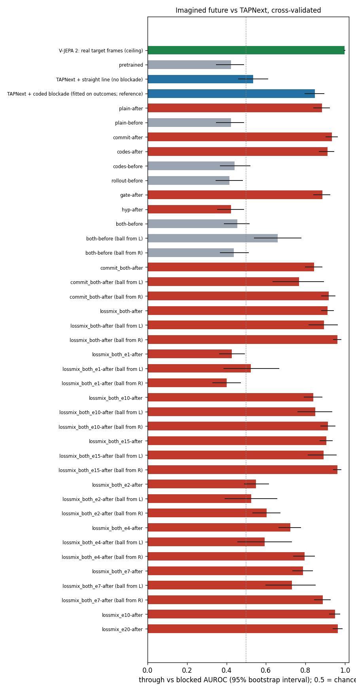

## Results

Through vs blocked AUROC from the imagined future (one ball, frozen decoder), cross-validated (5 folds, seed 0). `auroc_ci`: 95% bootstrap interval over clips. `delta_vs_before_ci` / `p_no_gain`: paired bootstrap against the same variant's pretrained predictor on the same clips (p_no_gain = share of resamples with no gain). TAPNext + coded blockade fits its blockade on outcomes, so it is a reference, not an evaluation. Runs named -long / -frac use the variant picked as best on these same folds, so their numbers are slightly optimistic.

| method | phase | outcome_auroc | auroc_ci | delta_vs_before_ci | p_no_gain | one_ball_p_correct | balanced_accuracy | cell_auroc | far_cell_auroc | argmax_hit_rate | overfit_folds | best_epochs |
|---|---|---|---|---|---|---|---|---|---|---|---|---|
| V-JEPA 2: real target frames (ceiling) | ceiling | 0.998 | [0.995, 1.0] | - | - | 0.673 | 0.725 | 0.971 | - | - | - | - |
| V-JEPA 2 pretrained | before | 0.422 | [0.348, 0.487] | - | - | 0.328 | 0.333 | 0.658 | - | 0.199 | - | - |
| TAPNext + straight line (no blockade) | baseline | 0.536 | [0.46, 0.609] | - | - | 0.333 | 0.333 | 0.596 | - | - | - | - |
| TAPNext + coded blockade (fitted on outcomes; reference) | baseline | 0.848 | [0.797, 0.894] | - | - | 0.52 | 0.525 | 0.554 | - | - | - | - |
| V-JEPA 2 plain-after | after | 0.884 | [0.841, 0.921] | [0.38, 0.542] | 0.0 | 0.376 | 0.431 | 0.803 | - | 0.483 | 0/5 | 10/10/9/10/10 |
| V-JEPA 2 plain-before | before | 0.422 | [0.348, 0.487] | - | - | 0.328 | 0.333 | 0.658 | - | 0.199 | 0/5 | 0/0/0/0/0 |
| V-JEPA 2 commit-after | after | 0.934 | [0.903, 0.961] | [0.434, 0.591] | 0.0 | 0.46 | 0.586 | 0.834 | 0.807 | 0.58 | 0/5 | 10/7/10/9/10 |
| V-JEPA 2 codes-after | after | 0.911 | [0.87, 0.944] | [0.383, 0.56] | 0.0 | 0.52 | 0.571 | 0.731 | 0.71 | 0.463 | 0/5 | 10/10/10/10/9 |
| V-JEPA 2 codes-before | before | 0.44 | [0.369, 0.519] | - | - | 0.33 | 0.329 | 0.571 | 0.504 | 0.134 | 0/5 | 0/0/0/0/0 |
| V-JEPA 2 rollout-before | before | 0.415 | [0.346, 0.481] | - | - | 0.333 | 0.333 | 0.675 | 0.548 | 0.154 | 0/5 | 0/0/0/0/0 |
| V-JEPA 2 gate-after | after | 0.885 | [0.842, 0.924] | [0.383, 0.544] | 0.0 | 0.371 | 0.383 | 0.803 | 0.769 | 0.478 | 0/5 | 10/10/9/10/10 |
| V-JEPA 2 hyp-after | after | 0.423 | [0.355, 0.488] | [-0.072, 0.075] | 0.521 | 0.328 | 0.333 | 0.665 | 0.544 | 0.23 | 1/5 | 10/3/7/2/1 |
| V-JEPA 2 both-before | before | 0.454 | [0.389, 0.516] | - | - | 0.337 | 0.396 | 0.666 | 0.56 | 0.177 | 0/5 | 0/0/0/0/0 |
| V-JEPA 2 both-before (ball from L) | before | 0.66 | [0.541, 0.777] | - | - | 0.352 | 0.333 | - | - | - | - | - |
| V-JEPA 2 both-before (ball from R) | before | 0.437 | [0.368, 0.511] | - | - | 0.329 | 0.333 | - | - | - | - | - |
| V-JEPA 2 commit_both-after | after | 0.843 | [0.8, 0.884] | [0.338, 0.451] | 0.0 | 0.451 | 0.486 | 0.846 | 0.831 | 0.551 | 0/5 | 10/10/9/8/10 |
| V-JEPA 2 commit_both-after (ball from L) | after | 0.767 | [0.636, 0.892] | [-0.015, 0.234] | 0.049 | 0.467 | 0.545 | - | - | - | - | - |
| V-JEPA 2 commit_both-after (ball from R) | after | 0.917 | [0.881, 0.95] | [0.406, 0.554] | 0.0 | 0.475 | 0.574 | - | - | - | - | - |
| V-JEPA 2 lossmix_both-after | after | 0.912 | [0.881, 0.941] | [0.399, 0.52] | 0.0 | 0.507 | 0.509 | 0.873 | 0.86 | 0.661 | 0/5 | 18/16/20/18/17 |
| V-JEPA 2 lossmix_both-after (ball from L) | after | 0.893 | [0.817, 0.961] | [0.103, 0.36] | 0.0 | 0.441 | 0.465 | - | - | - | - | - |
| V-JEPA 2 lossmix_both-after (ball from R) | after | 0.961 | [0.941, 0.98] | [0.448, 0.598] | 0.0 | 0.533 | 0.602 | - | - | - | - | - |
| V-JEPA 2 lossmix_both_e1-after | after | 0.427 | [0.365, 0.492] | - | - | 0.315 | 0.276 | 0.784 | 0.671 | 0.382 | - | - |
| V-JEPA 2 lossmix_both_e1-after (ball from L) | after | 0.523 | [0.386, 0.665] | - | - | 0.38 | 0.542 | - | - | - | - | - |
| V-JEPA 2 lossmix_both_e1-after (ball from R) | after | 0.401 | [0.331, 0.471] | - | - | 0.33 | 0.326 | - | - | - | - | - |
| V-JEPA 2 lossmix_both_e10-after | after | 0.839 | [0.794, 0.883] | - | - | 0.464 | 0.494 | 0.859 | 0.841 | 0.582 | - | - |
| V-JEPA 2 lossmix_both_e10-after (ball from L) | after | 0.85 | [0.762, 0.934] | - | - | 0.436 | 0.333 | - | - | - | - | - |
| V-JEPA 2 lossmix_both_e10-after (ball from R) | after | 0.914 | [0.878, 0.95] | - | - | 0.485 | 0.564 | - | - | - | - | - |
| V-JEPA 2 lossmix_both_e15-after | after | 0.906 | [0.874, 0.936] | - | - | 0.504 | 0.493 | 0.876 | 0.863 | 0.642 | - | - |
| V-JEPA 2 lossmix_both_e15-after (ball from L) | after | 0.891 | [0.813, 0.956] | - | - | 0.442 | 0.458 | - | - | - | - | - |
| V-JEPA 2 lossmix_both_e15-after (ball from R) | after | 0.962 | [0.942, 0.98] | - | - | 0.531 | 0.578 | - | - | - | - | - |
| V-JEPA 2 lossmix_both_e2-after | after | 0.549 | [0.491, 0.614] | - | - | 0.33 | 0.284 | 0.794 | 0.72 | 0.378 | - | - |
| V-JEPA 2 lossmix_both_e2-after (ball from L) | after | 0.526 | [0.392, 0.656] | - | - | 0.402 | 0.646 | - | - | - | - | - |
| V-JEPA 2 lossmix_both_e2-after (ball from R) | after | 0.603 | [0.534, 0.671] | - | - | 0.343 | 0.303 | - | - | - | - | - |
| V-JEPA 2 lossmix_both_e4-after | after | 0.723 | [0.666, 0.776] | - | - | 0.398 | 0.426 | 0.819 | 0.817 | 0.46 | - | - |
| V-JEPA 2 lossmix_both_e4-after (ball from L) | after | 0.593 | [0.456, 0.729] | - | - | 0.4 | 0.545 | - | - | - | - | - |
| V-JEPA 2 lossmix_both_e4-after (ball from R) | after | 0.796 | [0.739, 0.845] | - | - | 0.424 | 0.471 | - | - | - | - | - |
| V-JEPA 2 lossmix_both_e7-after | after | 0.787 | [0.736, 0.835] | - | - | 0.436 | 0.476 | 0.83 | 0.817 | 0.514 | - | - |
| V-JEPA 2 lossmix_both_e7-after (ball from L) | after | 0.731 | [0.6, 0.849] | - | - | 0.399 | 0.444 | - | - | - | - | - |
| V-JEPA 2 lossmix_both_e7-after (ball from R) | after | 0.888 | [0.845, 0.926] | - | - | 0.465 | 0.555 | - | - | - | - | - |
| V-JEPA 2 lossmix_e10-after | after | 0.949 | [0.921, 0.973] | [0.459, 0.599] | 0.0 | 0.487 | 0.613 | 0.851 | 0.835 | 0.637 | - | - |
| V-JEPA 2 lossmix_e20-after | after | 0.964 | [0.939, 0.985] | [0.472, 0.616] | 0.0 | 0.551 | 0.651 | 0.872 | 0.88 | 0.701 | 0/5 | 18/20/17/17/18 |
| V-JEPA 2 lossmix_open-after | after | 0.912 | [0.88, 0.944] | - | - | 0.534 | 0.556 | 0.879 | 0.869 | 0.673 | 0/5 | 17/19/19/16/17 |
| V-JEPA 2 lossmix_open-after (ball from L) | after | 0.922 | [0.855, 0.969] | - | - | 0.461 | 0.396 | - | - | - | - | - |
| V-JEPA 2 lossmix_open-after (ball from R) | after | 0.959 | [0.935, 0.979] | - | - | 0.555 | 0.64 | - | - | - | - | - |
| V-JEPA 2 lossmix_open_e10-after | after | 0.868 | [0.829, 0.907] | - | - | 0.492 | 0.496 | 0.864 | 0.853 | 0.613 | - | - |
| V-JEPA 2 lossmix_open_e10-after (ball from L) | after | 0.909 | [0.846, 0.962] | - | - | 0.433 | 0.361 | - | - | - | - | - |
| V-JEPA 2 lossmix_open_e10-after (ball from R) | after | 0.93 | [0.898, 0.959] | - | - | 0.512 | 0.577 | - | - | - | - | - |
| V-JEPA 2 lossmix_topup-after | after | 0.925 | [0.895, 0.954] | - | - | 0.535 | 0.523 | 0.883 | 0.874 | 0.693 | 0/5 | 5/5/5/4/4 |
| V-JEPA 2 lossmix_topup-after (ball from L) | after | 0.873 | [0.784, 0.949] | - | - | 0.446 | 0.358 | - | - | - | - | - |
| V-JEPA 2 lossmix_topup-after (ball from R) | after | 0.971 | [0.952, 0.987] | - | - | 0.57 | 0.622 | - | - | - | - | - |

### Generalisation of commit (held out, never trained on)

| group | clips | AUROC before | AUROC after | AUROC real frames | mirrored: before | mirrored: after | mirrored: real frames |
|---|---|---|---|---|---|---|---|
| other side (from L) | 83 | 0.643 | 0.355 | 0.98 | 0.726 | 0.53 | 0.996 |

other side (from L), by height at the plank: the blockade range fitted on the seen clips (176.3-329.4 px) gets 0.855 of these outcomes right. How well the "gets through" score follows that range (AUROC): real frames 0.842948717948718, before 0.6503496503496504, after 0.31410256410256415, mirrored after 0.49533799533799533. Figure: `vjepa2/plan/generalise/commit/height.png`.

### Generalisation of plain (held out, never trained on)

| group | clips | AUROC before | AUROC after | AUROC real frames | mirrored: before | mirrored: after | mirrored: real frames |
|---|---|---|---|---|---|---|---|
| other side (from L) | 83 | 0.643 | 0.39 | 0.98 | 0.726 | 0.523 | 0.996 |

other side (from L), by height at the plank: the blockade range fitted on the seen clips (176.3-329.4 px) gets 0.855 of these outcomes right. How well the "gets through" score follows that range (AUROC): real frames 0.842948717948718, before 0.6503496503496504, after 0.32517482517482516, mirrored after 0.5308857808857809. Figure: `vjepa2/plan/generalise/plain/height.png`.

### Interpretation: plain-after

- Feature change on the plank: 0.188 of the total (the plank is 0.172 of the frame), correlation 0.355.
- Patching in one group: highest AUROC from `layer 11` (0.426); before 0.422, after 0.885.
- Figures: `vjepa2/plan/interpret/plain-after/change_map.png`, `layer_patching.png`.

## Slope test: uphill vs downhill at matched speed, in ball sizes

s = (downhill - uphill acceleration along the motion) / 2 at matched speed, in ball diameters per step² (1 step = 1/8 s); friction cancels. Positions are mapped onto the table with the ball's size (camera calibration from real frames only). Clips: one fit per clip over its longest run of 5+ target steps on open table; open = the open-table clips (scripts/cut_open_clips.py, scored only), plank = the plank clips' target steps. See models/vjepa2/slope_test.py.

Calibration: radius = -0.0015 x + 0.0392 y + 13.49 px (R² 0.925, 13776 frames; radius [14.97, 29.28] px across the table).

| measure | s | 95% CI | downhill a | uphill a | n down | n up |
|---|---|---|---|---|---|---|
| real ball, whole video (285 stretches) | 0.0299 | [0.02748, 0.03238] | -0.0062 | -0.0669 | 396 | 138 |
| open: real ball (tracker) | 0.0334 | [0.0185, 0.0442] | 0.00767 | -0.05048 | 25 | 14 |
| open: decoder on real frames | 0.0289 | [0.01081, 0.04464] | 0.01929 | -0.0333 | 30 | 16 |
| open: imagined, both-before | None | None | None | None | 0 | 0 |
| open: imagined, lossmix_both-after | -0.0213 | [-0.051, 0.02165] | -0.07963 | -0.02239 | 17 | 27 |
| open: imagined, lossmix_topup-after | 0.003 | [-0.0138, 0.01021] | -0.02465 | -0.0145 | 23 | 19 |
| plank: real ball (tracker) | 0.0299 | [0.02096, 0.039] | -0.01331 | -0.0589 | 26 | 38 |
| plank: decoder on real frames | 0.0254 | [0.0073, 0.05141] | -0.04056 | -0.07571 | 31 | 42 |
| plank: imagined, both-before | None | None | None | None | 0 | 0 |
| plank: imagined, lossmix_both_e1-after | None | None | None | None | 0 | 0 |
| plank: imagined, lossmix_both_e2-after | None | None | None | None | 0 | 0 |
| plank: imagined, lossmix_both_e4-after | None | None | 0.01075 | None | 2 | 0 |
| plank: imagined, lossmix_both_e7-after | -0.0009 | [-0.02639, 0.01924] | -0.037 | -0.03526 | 7 | 3 |
| plank: imagined, lossmix_both_e10-after | 0.0019 | [-0.03258, 0.04057] | -0.00519 | 0.00281 | 9 | 12 |
| plank: imagined, lossmix_both_e15-after | 0.0188 | [-0.02219, 0.05371] | 0.00593 | -0.03708 | 10 | 16 |
| plank: imagined, lossmix_both-after | 0.0113 | [-0.03462, 0.06416] | 0.01538 | -0.02577 | 16 | 15 |
| plank: imagined, commit_both-after | None | None | None | None | 0 | 0 |
| plank: imagined, lossmix_e10-after | None | None | 0.01223 | None | 2 | 0 |
| plank: imagined, lossmix_e20-after | None | [-0.09314, -0.02962] | -0.02791 | 0.0797 | 13 | 1 |
| plank: imagined, lossmix_open_e10-after | -0.0817 | [-0.14351, 0.01186] | -0.12672 | -0.01679 | 5 | 20 |
| plank: imagined, lossmix_open-after | -0.0521 | [-0.14418, -0.00123] | -0.22222 | -0.04481 | 9 | 29 |
| plank: imagined, lossmix_topup-after | 0.0002 | [-0.0371, 0.04319] | -0.03332 | -0.0203 | 13 | 24 |

### Learning curve (C: both directions, loss-weighted sampling)

| epoch | s, open clips | 95% CI | s, plank clips | 95% CI | AUROC ball from R | AUROC ball from L |
|---|---|---|---|---|---|---|
| 0 | None | None | None | None | 0.437 | 0.66 |
| 1 | None | None | None | None | 0.401 | 0.523 |
| 2 | None | None | None | None | 0.603 | 0.526 |
| 4 | None | None | None | None | 0.796 | 0.593 |
| 7 | None | None | -0.0009 | [-0.02639, 0.01924] | 0.888 | 0.731 |
| 10 | None | None | 0.0019 | [-0.03258, 0.04057] | 0.914 | 0.85 |
| 15 | None | None | 0.0188 | [-0.02219, 0.05371] | 0.962 | 0.891 |
| 20 | -0.0213 | [-0.051, 0.02165] | 0.0113 | [-0.03462, 0.06416] | 0.961 | 0.893 |

Imagined paths count only target steps where the imagined ball is clearly visible (map peak >= 0.2) on open table, so n shows how often the model draws the ball at all. Figures: `slope_test/epochs.png`, `slope_test/real_acc_vs_speed.png`.

## Slope map (uniform pull over the whole table)

g = acceleration from the table after removing friction (a = g - mu * direction of motion), ball diameters per step²; x is left/right in the image (negative = pulled left = downhill), y is towards the camera. 95% intervals by bootstrap over clips. Figure: `slope_map/slope_map.png`.

| track | g_x | 95% CI | g_y | 95% CI | friction mu | stretches | clips |
|---|---|---|---|---|---|---|---|
| real ball (tracker) | -0.0267 | [-0.03, -0.0234] | -0.0086 | [-0.0106, -0.0069] | 0.0352 | 985 | 235 |
| probe on real frames (coarse) | -0.0309 | [-0.0388, -0.0225] | -0.0063 | [-0.0098, -0.0029] | 0.0269 | 632 | 176 |
| probe on real frames (sharp) | -0.0384 | [-0.0461, -0.0307] | -0.0068 | [-0.01, -0.0036] | 0.0285 | 621 | 169 |
| imagined, before post-training (sharp) | - | - | - | - | - | 0 | 0 |
| imagined, after post-training (C, 20 ep) (sharp) | -0.0214 | [-0.0439, 0.0002] | -0.0115 | [-0.0198, -0.0038] | 0.0257 | 292 | 95 |
| imagined, after (E: + open clips) (sharp) | 0.0069 | [-0.0336, 0.0583] | -0.0078 | [-0.0181, 0.0023] | 0.0505 | 77 | 36 |
| imagined, after (G: C + 5 ep aligned open clips) (sharp) | -0.0152 | [-0.0298, 0.0004] | -0.0067 | [-0.0123, -0.0014] | 0.0157 | 397 | 112 |

### Downhill vs uphill on the same steps as the real ball

Acceleration along the motion (negative = slowing), median over stretches where both the track and the real ball are usable, split by the real ball's direction (left = downhill). s = (down - up) / 2; the real ball's s on the same stretches says what a track that follows the slope would give.

| track | stretches down / up | track: down | up | s | 95% CI | real ball: down | up | s | 95% CI |
|---|---|---|---|---|---|---|---|---|---|
| probe on real frames (sharp) | 202 / 216 | -0.0118 | -0.0395 | 0.0138 | [0.0059, 0.025] | 0.0009 | -0.0486 | 0.0248 | [0.0208, 0.0307] |
| imagined, after post-training (C, 20 ep) | 70 / 65 | -0.0126 | -0.0504 | 0.0189 | [-0.0192, 0.054] | 0.0033 | -0.0606 | 0.032 | [0.0205, 0.0422] |
| imagined, after (E: + open clips) | 2 / 28 | - | - | - | - | - | - | - | - |
| imagined, after (G: C + 5 ep aligned open clips) | 124 / 92 | -0.0026 | -0.0496 | 0.0235 | [-0.0071, 0.0401] | 0.0015 | -0.0604 | 0.0309 | [0.0214, 0.039] |

## Table slope from ball tracks

s: slope term along the table (px/step², downhill = left; 1 step = 1/8 s). Share of S0: the source's s over the tracker's. Measured on open-table steps only; nothing fitted to read a model. See models/vjepa2/slope.py.

| source | clips | s (1-D) | 95% CI | share of S0 | s (2-D, -Gx) | 95% CI | G (x, y) | right of plank | left of plank | degrees |
|---|---|---|---|---|---|---|---|---|---|---|
| S0 tracker (all steps) | 327 | 2.4193 | [1.1353, 3.4569] | 1.0 | 1.768 | [1.1513, 2.2867] | [-1.768, -0.1039] | 5.6029 | -7.1953 | None |
| S0t tracker (target steps) | 176 | 0.1014 | [-0.4539, 0.7696] | 0.04 | 0.4005 | [-0.0629, 0.9099] | [-0.4005, -0.8382] | 2.2894 | None | None |
| S1 decoder, real frames | 176 | 0.2466 | [-0.8097, 1.3953] | 0.1 | -0.0916 | [-0.8077, 0.7091] | [0.0916, -0.3688] | 2.1962 | None | None |
| S2 imagined, pretrained | 176 | 0.0702 | [-5.0578, 5.0914] | 0.03 | 0.9329 | [-1.7517, 3.7662] | [-0.9329, 1.5398] | 4.9284 | None | None |
| S3 imagined, B right only @10 | 113 | 1.1506 | [-15.2029, 18.6548] | 0.48 | -0.2173 | [-7.1715, 7.2708] | [0.2173, -5.9285] | 42.7057 | -16.8352 | None |
| S3 imagined, B right only @20 | 114 | -13.2919 | [-26.4122, 4.3605] | -5.49 | -2.8377 | [-10.4806, 5.1896] | [2.8377, -4.0594] | 33.2964 | -67.5737 | None |
| S4 imagined, A both directions | 176 | -1.3353 | [-11.9186, 8.5185] | -0.55 | -0.1729 | [-4.2703, 4.1145] | [0.1729, 0.0307] | 34.209 | -27.9645 | None |

Figures: `slope/acc_vs_speed.png` (downhill and uphill acceleration by speed), `slope/gradient_map.png` (G per region).

## Research scope 2026-10-09

From per_clip.json (frozen decoder) and blocker/*/crossing.json; nothing is fitted. See models/vjepa2/scope_report.py.

### Narrow gap and both sides: mean P(ball beyond the plank) by the height the ball reaches the plank

| run | side | wide gap (104-186) | narrow gap (315-367) | blocked middle (186-315) | AUROC at y 300-380 | AUROC all |
|---|---|---|---|---|---|---|
| real frames | R | 0.947 (n 82) | 0.911 (n 26) | 0.075 (n 106) | 0.997 (n 52) | 0.998 |
| pretrained | R | 0.175 (n 82) | 0.189 (n 26) | 0.185 (n 106) | 0.451 (n 52) | 0.422 |
| plain-after | R | 0.302 (n 82) | 0.255 (n 26) | 0.153 (n 106) | 0.787 (n 52) | 0.884 |
| commit-after | R | 0.602 (n 82) | 0.437 (n 26) | 0.133 (n 106) | 0.869 (n 52) | 0.934 |
| codes-after | R | 0.846 (n 82) | 0.486 (n 26) | 0.112 (n 106) | 0.868 (n 52) | 0.911 |
| lossmix_e10-after | R | 0.642 (n 82) | 0.539 (n 26) | 0.121 (n 106) | 0.908 (n 52) | 0.949 |
| lossmix_e20-after | R | 0.819 (n 82) | 0.786 (n 26) | 0.114 (n 106) | 0.923 (n 52) | 0.964 |
| real frames | L | 0.966 (n 25) | 0.992 (n 7) | 0.481 (n 40) | 1.0 (n 10) | 0.98 |
| both-before | L | 0.735 (n 25) | 0.699 (n 7) | 0.695 (n 40) | 1.0 (n 10) | 0.66 |
| real frames | R | 0.959 (n 82) | 0.919 (n 26) | 0.07 (n 106) | 0.996 (n 52) | 0.999 |
| both-before | R | 0.168 (n 82) | 0.179 (n 26) | 0.178 (n 106) | 0.501 (n 52) | 0.437 |
| commit_both-after | L | 0.933 (n 25) | 0.438 (n 7) | 0.559 (n 40) | 0.571 (n 10) | 0.767 |
| commit_both-after | R | 0.67 (n 82) | 0.445 (n 26) | 0.13 (n 106) | 0.92 (n 52) | 0.917 |
| lossmix_both-after | L | 0.94 (n 25) | 0.779 (n 7) | 0.517 (n 40) | 0.333 (n 10) | 0.893 |
| lossmix_both-after | R | 0.787 (n 82) | 0.673 (n 26) | 0.084 (n 106) | 0.924 (n 52) | 0.961 |
| lossmix_open-after | L | 0.949 (n 25) | 0.891 (n 7) | 0.513 (n 40) | 0.429 (n 10) | 0.922 |
| lossmix_open-after | R | 0.854 (n 82) | 0.609 (n 26) | 0.081 (n 106) | 0.891 (n 52) | 0.959 |
| lossmix_topup-after | L | 0.945 (n 25) | 0.784 (n 7) | 0.525 (n 40) | 0.452 (n 10) | 0.873 |
| lossmix_topup-after | R | 0.867 (n 82) | 0.763 (n 26) | 0.068 (n 106) | 0.902 (n 52) | 0.971 |

Figure: `scope/height_profile.png`. The slope (downhill) results are in `slope/` (slope.py).

