# RobustWorld: results so far (updated 2026-10-11)

**Question.** A ball rolls under a plank. A hidden blocker under the plank stops some passes
("hidden", or "bounce" when the ball comes back). Can V-JEPA 2 learn where the invisible
blocker is, purely by post-training its predictor on our video?

**Short answer so far (updated 2026-10-11).**

- **Right-entry passes (the training direction): yes.** Post-training lifts through-vs-blocked
  AUROC from **0.42** (pretrained, below chance) to **0.96**, beating the hand-coded TAPNext +
  fitted-blockade reference (0.85). The best runs are commit with loss-weighted sampling for 20
  epochs: B, trained on right-entry clips only, and C, trained on both directions.
- **Learning from one direction does not transfer.** Models trained only on right-entry clips get
  *worse* on left-entry clips (0.64 → 0.35–0.39), and mirroring the clips does not rescue them.
- **Training on both directions fixes the other side.** **C reaches 0.96 from the right and 0.89
  from the left** (left clips scored only on held-out folds). C is the best model overall.
- **The narrow gap is now learnt.** Loss-weighted sampling plus 20 epochs lifts the imagined ball
  in the narrow gap from 0.44 to 0.79 (real frames 0.91).
- **The table slope is not learnt yet.** The imagined slope term is 0.007, against 0.030 for the
  real ball, with a CI that includes 0. The frozen decoder's 32 px grid is too coarse to measure
  the slope even on real frames.

Sources (all figures here are copies, so they render after `git pull`):
post-training on PR #3 (`claude/colab-two-day-plan-3gn90a` @ `18840c8`,
`results/2026-10-04_2110_twoday/`, Kaggle sessions up to #7 on 2026-10-11), probing on PR #4
(`claude/vjepa-probing-overnight` @ `919d440`, `results/2026-10-05_0425_vjepa-probing/`),
zero-shot on `main` (`docs/results/ball_comparison.md`).

> **Plans:** [NEXT_STEPS_PLAN.md](NEXT_STEPS_PLAN.md) (2026-10-09) and
> [RESEARCH_SCOPE.md](RESEARCH_SCOPE.md) (the run list for the latest Kaggle sessions: B, A, C, slope).
> **New since 2026-10-08:** sections 4–6 and the updated 8–9.

---

## 1. Setup in one paragraph

- **Data:** one fixed-camera recording (`whole.mp4`) cut into 48-frame clips at 16 fps.
  - Training direction: 254 right-entry clips (111 through, 77 hidden, 66 bounce).
  - Held-out other side: 83 left-entry clips (32 through, 48 bounce, only 3 hidden).
- **Model:** V-JEPA 2 ViT-L. Encoder frozen; only the predictor is post-trained (10 epochs, L1 in
  layer-normalised latent space), 5-fold CV (`cv_folds`, seed 0).
- **Scoring (CLAUDE.md rule):** every V-JEPA number is read through the frozen `eval_decoder`.
  It is linear, fitted only on real context-half features with same-frame ball positions. No readout
  ever sees outcomes or predictions.
- **Headline metric:** through-vs-blocked AUROC, from how much ball the imagined future puts beyond
  the plank (one ball assumed; 0.5 = chance). Paired bootstrap of after − before on the same clips.

## 2. Probing: can we read the ball out of V-JEPA at all? (PR #4)

**Yes, near-perfectly, so the readout is not the bottleneck.**

- Any per-token or 3×3 linear probe finds the ball on real frames:
  - context-cell AUROC ≈ 1.000;
  - far-side cells (never seen with a ball in training) 0.996–0.999;
  - median error 14–20 px on a 512 px frame.
- Pooling tokens (global input) fails: far-cell AUROC 0.33–0.58. MLP vs linear, LN vs raw: no
  difference. Sigmoid beats softmax.
- The existing `eval_decoder` (last layer, linear, per token, LN, sigmoid) is within 0.002 of the
  best config. It reads the real outcome at AUROC 0.99–1.00, so the ceiling for an imagined future is ≈1.0.
- It also transfers to the other side on real frames: cell AUROC 0.98, far-cell 0.995, outcome 0.97–1.0.

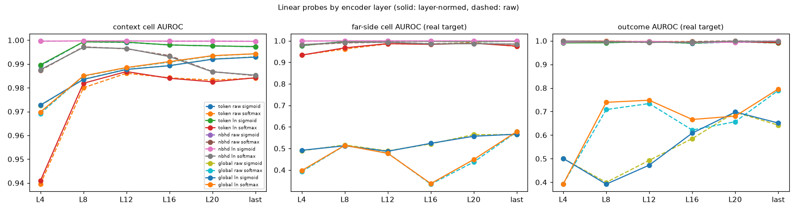
*Per-token / neighbourhood probes (top lines) are ≈1.0 at every layer from L8 up. Pooled
"global" probes (bottom lines) fail on far-side cells.*

**The pretrained predictor knows nothing about the blockade.** Imagined outcome AUROC is
0.23–0.53 across 24 probe configs. It almost never imagines the ball past the plank, so it
effectively "predicts blocked" for every pass.

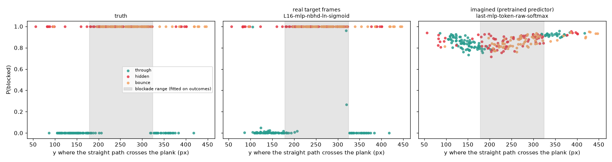
*Middle: real frames separate outcomes perfectly. Right: the pretrained predictor's imagined
P(blocked) is a flat high band whatever the crossing point.*

**Label-free signals:**

- **The blocker did not move during the recording.** The fitted range is 178–320 px in the first
  14 min and 194–325 px in the last 14. The straight-line crossing is off by 21 px on average,
  and about 14% of passes fit no single range, so a ceiling of about 0.85 for any rule-based
  tracker is real.
- **Surprise notices failed passes even before training.** We paired each blocked pass with the
  through pass nearest in path and speed. The pretrained predictor is still more surprised on
  blocked passes: hidden +0.0037 (48/77 pairs, p = 0.003); bounce +0.015 (59/63, p < 0.001).
  Surprise is a valid, readout-free score.
- **The blocker is not visible.** Static token distinctiveness is slightly higher in the
  blockade rows, but the band runs across the whole frame. It is scene structure, not the blocker.

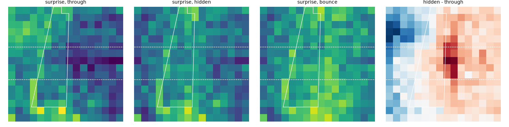
*Pretrained predictor error per cell. Right: hidden − through, highest at the plank's exit
edge in the blockade rows (raw comparison; path-matched numbers above).*

## 3. Post-training: does V-JEPA learn the blockade? (PR #3)

| method | AUROC [95% CI] | gain vs before [95% CI] | far-cell AUROC | ball hit rate | best epochs |
|---|---|---|---|---|---|
| Real target frames (ceiling) | 0.998 [0.995, 1.0] | – | – | – | – |
| Pretrained predictor | 0.422 [0.35, 0.49] | – | – | 0.20 | – |
| TAPNext + straight line | 0.536 [0.46, 0.61] | – | – | – | – |
| TAPNext + coded blockade (fitted on outcomes; reference) | 0.848 [0.80, 0.89] | – | – | – | – |
| **plain** (latent L1) | 0.884 [0.84, 0.92] | +0.38 to +0.54 | – | 0.48 | 10/10/9/10/10 |
| **commit** (motion-weighted L1 + contrast) | **0.934** [0.90, 0.96] | +0.43 to +0.59 | 0.81 | 0.58 | 10/7/10/9/10 |
| **codes** (256-code k-means, cross-entropy) | 0.911 [0.87, 0.94] | +0.38 to +0.56 | 0.71 | 0.46 | 10/10/10/10/9 |
| **gate** (copy-last-frame gate) | 0.885 [0.84, 0.92] | +0.38 to +0.54 | 0.77 | 0.48 | 10/10/9/10/10 |
| **hyp** (multi-hypothesis, winner-takes-all) | 0.423 [0.36, 0.49] | −0.07 to +0.08 (no gain) | 0.54 | 0.23 | 10/3/7/2/1 |

"Before" rows (codes-before 0.44, rollout-before 0.415) match the pretrained model, as they
should. Every successful run's gain CI excludes 0 (`p_no_gain` = 0.0).

### What commit (best of the 10-epoch round) actually imagines

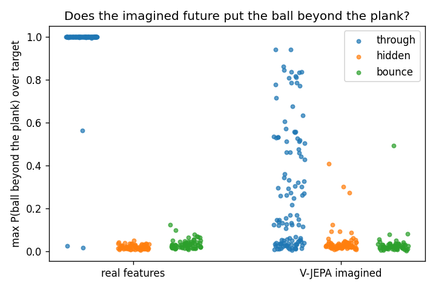
*commit-after. The pretrained predictor shows no ball past the plank for any clip (next figure).
After post-training, about half of the through passes get a clear imagined ball past the plank
(0.2–0.95), while hidden and bounce stay near 0. The other half of the through passes still
look blocked.*

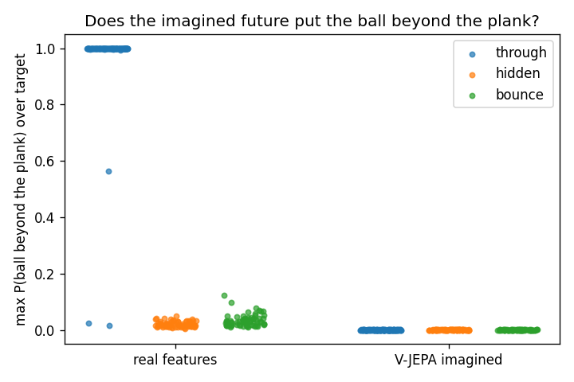

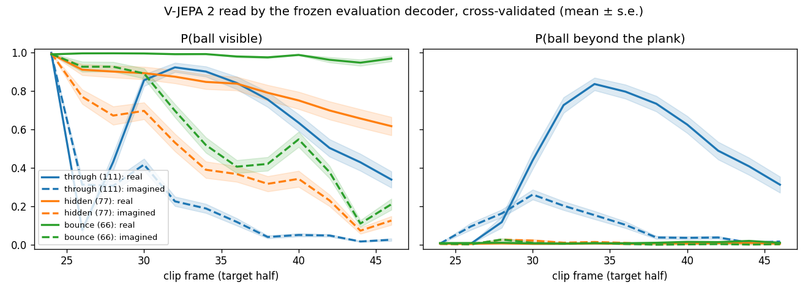
*Dashed = imagined, solid = real. The imagined "ball beyond plank" for through clips peaks at
≈0.26 vs ≈0.84 in reality, and fades early. The prediction is right in direction but faint.*

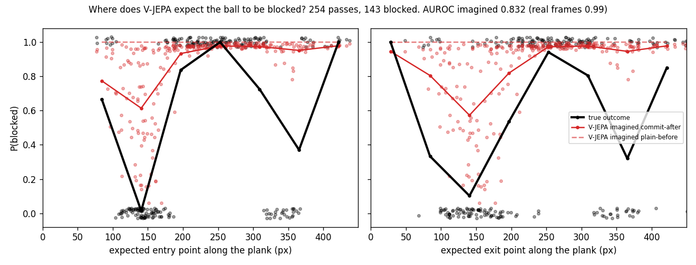
*Black = true outcome rate by crossing point, red = commit-after. There are two "through windows"
along the plank, near 140 px and near 360 px. commit learnt the **upper window only**. Passes
through the lower window are still predicted blocked. (P(blocked) here is the decoder's
normalised probability, so its AUROC is 0.83, not 0.93.)*

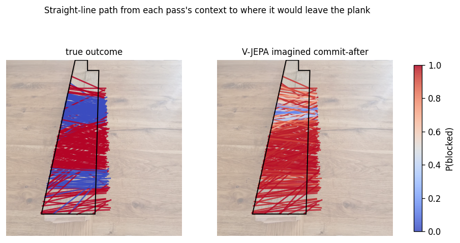
*The same thing on the image: the true map (left) has two blue bands, and the model (right) only
the upper one.*

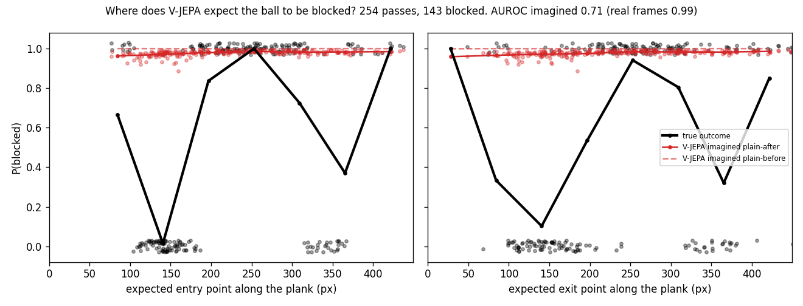
*plain-after for comparison. P(blocked) stays near 1 everywhere: its 0.88 AUROC comes from small
ranking shifts, not a clean "ball comes out" prediction. commit's motion weighting is what
makes the imagined ball visible.*

### Failed variants

- **Copy gate:** no change vs plain (0.885 vs 0.884). The scene was already clean; gating the
  background doesn't free capacity that matters.
- **Multi-hypothesis:** collapsed to pretrained level (0.42), with early best epochs (3/2/1) and
  1/5 folds flagged as overfitting. The imagined ball vanishes for every clip: winner-takes-all
  settled on one "no ball" future.

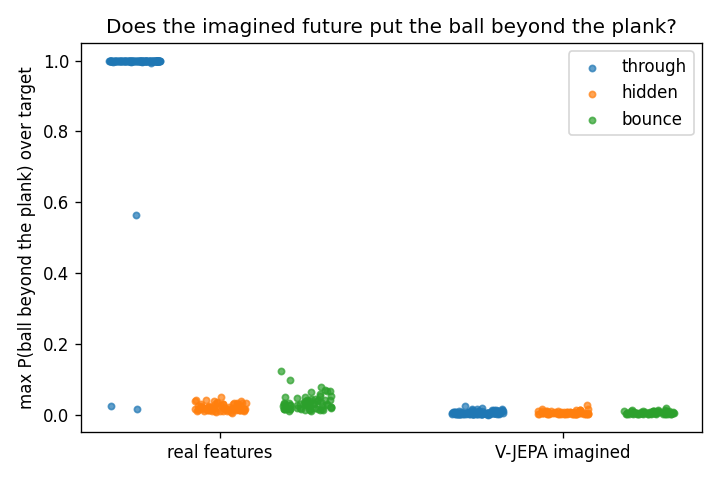

### Where the change sits (interpretation of plain)

- **In the image:** the feature change is spread across the frame. Only 18.8% of it is on the
  plank, which is 17.2% of the frame. For blocked clips, the decoded ball probability rises at
  the plank's entry edge: the model learnt to keep the ball there.
- **In the network:** patching any single layer into the pretrained predictor recovers nothing
  (≤ 0.43). Reverting a single layer hurts most for the embeddings (0.71) and layers 3–4
  (0.75 / 0.69); reverting layers 8–11 costs nothing. So the knowledge is distributed over the
  embeddings and early-to-mid layers, not stored in one place.

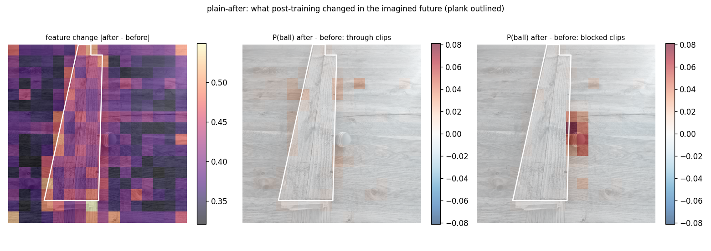
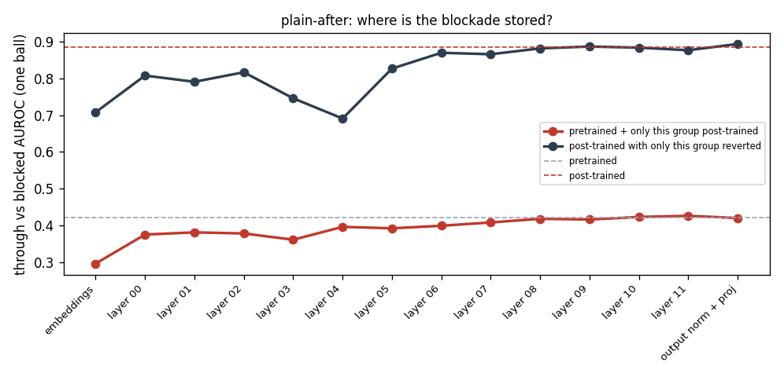

## 4. Training longer, with loss-weighted sampling: the narrow gap (new)

**What B changes.** B is commit with two changes:

- **Loss-weighted sampling:** each epoch, clips are drawn in proportion to their previous-epoch
  loss, with a floor. No outcome label is used.
- **Longer training:** 20 epochs with a cosine schedule, scored at epochs 10 and 20.

**Results:**

| run | AUROC [95% CI] | gain vs before [95% CI] | far-cell AUROC | ball hit rate | best epochs |
|---|---|---|---|---|---|
| commit-after (10 ep, reference) | 0.934 [0.90, 0.96] | +0.43 to +0.59 | 0.81 | 0.58 | 10/7/10/9/10 |
| B @ 10 epochs (`lossmix_e10`) | 0.949 [0.92, 0.97] | +0.46 to +0.60 | 0.84 | 0.64 | – |
| **B @ 20 epochs (`lossmix_e20`)** | **0.964** [0.94, 0.985] | +0.47 to +0.62 | **0.88** | **0.70** | 18/20/17/17/18 |

**Mean imagined P(ball beyond the plank), right-entry passes, by the height where the ball
reaches the plank:**

| run | wide gap (104–186 px) | narrow gap (315–367 px) | blocked middle | AUROC at y 300–380 |
|---|---|---|---|---|
| real frames | 0.947 | 0.911 | 0.075 | 0.997 |
| pretrained | 0.175 | 0.189 | 0.185 | 0.451 |
| commit-after | 0.602 | 0.437 | 0.133 | 0.869 |
| codes-after | 0.846 | 0.486 | 0.112 | 0.868 |
| B @ 10 | 0.642 | 0.539 | 0.121 | 0.908 |
| **B @ 20** | **0.819** | **0.786** | 0.114 | 0.923 |

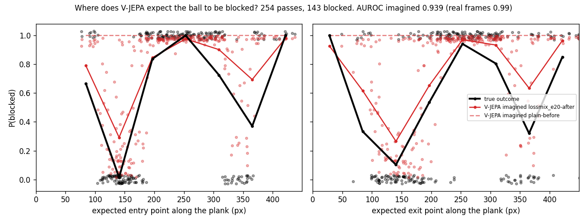
*B @ 20. Unlike commit (section 3), P(blocked) now also drops in the lower, narrow window near
360 px, so both through windows are learnt. The imagined ball is still weaker than real.*

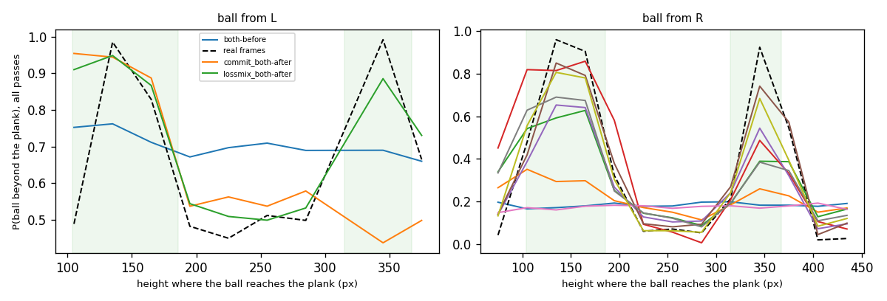
*Imagined P(ball beyond the plank) by height at the plank. Dashed = real frames; shaded = the
two gaps. Left panel: both-direction runs on left-entry passes. Right panel: all runs on
right-entry passes (numbers in the table above).*

Most of B's gain over commit comes from the second 10 epochs (0.949 → 0.964; narrow gap 0.54
→ 0.79). The sampling alone helps a little at epoch 10, although the learning rate is not at
zero there, so that comparison is mildly confounded.

## 5. Generalisation: the other side (updated)

### 5a. Right-only models fail on the other side, and mirroring doesn't help

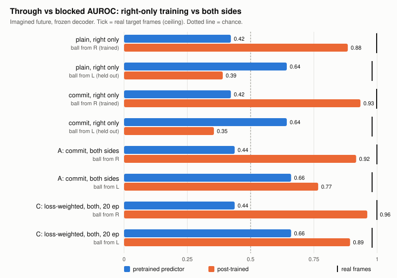

| model (trained on right only) | left: before | after | real frames | **mirrored: before** | **mirrored: after** | mirrored: real |
|---|---|---|---|---|---|---|
| plain | 0.643 | 0.390 | 0.98 | 0.726 | 0.523 | 0.996 |
| commit | 0.643 | 0.355 | 0.98 | 0.726 | 0.530 | 0.996 |

**Mirror test.** We flipped the left clips left↔right, so each ball enters from the right like
the training clips, at the same height. Post-training still does not help: it moves the mirrored
clips from 0.73 to chance (0.52–0.53).

**Height test.** On the left clips, the blockade range fitted on the right clips (176–329 px)
gets 85.5% of outcomes right. So the blocker is at the same height from both sides. The question
is whether the model's "gets through" score follows that range (AUROC):

| score | real frames | before | after (plain / commit) | mirrored after (plain / commit) |
|---|---|---|---|---|
| AUROC vs the height range | 0.84 | 0.65 | **0.33 / 0.31** (inverted) | 0.53 / 0.50 (chance) |

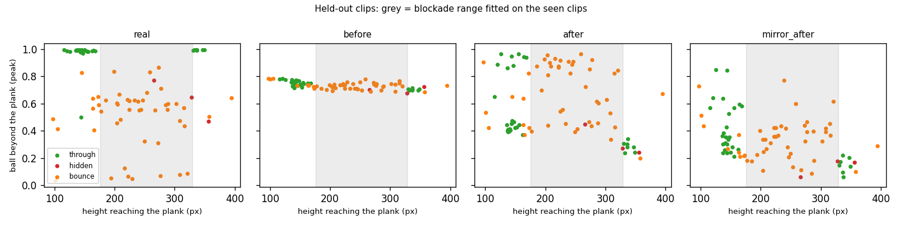
*Left-entry clips (commit). Grey = the blockade range. After training (third panel), bounces
inside the range get a *high* "ball beyond the plank" score and through passes in the gaps a low
one: the model's map is inverted for this direction.*

**My reading (inferred, not tested directly):** the right-only model learnt an *image-space*
outcome map, not a direction-relative one. In the training clips, at blockade heights, a
bouncing ball ends up on the **right** of the plank, and at gap heights a passing ball ends up on
the **left**. Applied to balls from the left, this predicts:

- blockade heights → ball on the right ("came through");
- gap heights → ball on the left ("stopped").

That is exactly the inversion seen. The mirrored clips are out of distribution (a mirrored
scene), so they land near chance. Either way, the right-only model does not hold "a solid
object at a place" that applies to any direction.

### 5b. Training on both directions fixes it

These runs use `cv_folds` over all 337 clips (254 from the right + 83 from the left). Each side is
scored on held-out folds, so the left side is no longer a held-out *direction*. It is held-out
clips of a direction seen in training.

| run | both sides | ball from R | ball from L | gain on L [95% CI] |
|---|---|---|---|---|
| both-before (pretrained) | 0.454 | 0.437 | 0.660 | – |
| A: commit, both, 10 ep (`commit_both`) | 0.843 | 0.917 | 0.767 | −0.02 to +0.23 (p = 0.05) |
| **C: commit + loss-weighted, both, 20 ep (`lossmix_both`)** | **0.912** | **0.961** | **0.893** | **+0.10 to +0.36** |

**Findings:**

- C is the best model across both sides.
- Adding left clips costs nothing on the right: 0.961, the same as right-only B's 0.964.
- In the left-entry height profile (section 4 figure, left panel), C follows the real curve in
  both gaps. A misses the narrow gap.
- Caveat: the left side has only 7 narrow-gap passes and 10 passes at y 300–380, so its
  narrow-gap numbers are noisy.

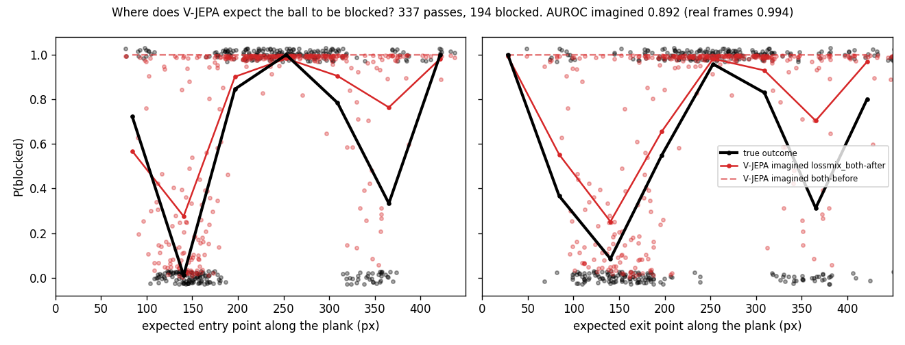
*C on all 337 passes: both windows are learnt; AUROC 0.89 on this normalised score
(real frames 0.99).*

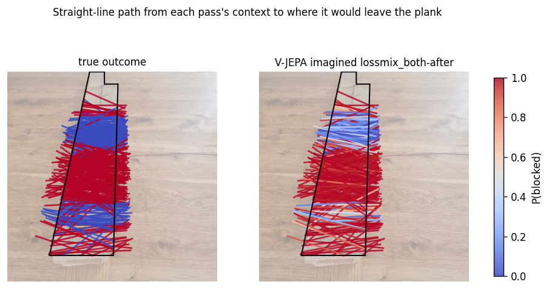

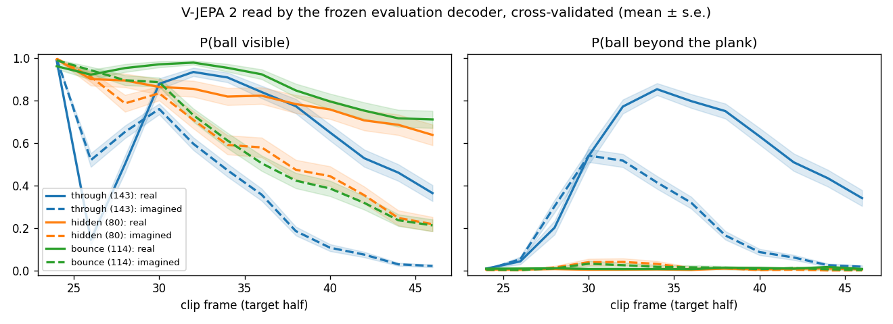

### 5c. Learning curve (C, scored at saved epochs)

| epoch | 0 | 1 | 2 | 4 | 7 | 10 | 15 | 20 |
|---|---|---|---|---|---|---|---|---|
| AUROC, ball from R | 0.437 | 0.401 | 0.603 | 0.796 | 0.888 | 0.914 | **0.962** | 0.961 |
| AUROC, ball from L | 0.660 | 0.523 | 0.526 | 0.593 | 0.731 | 0.850 | **0.891** | 0.893 |

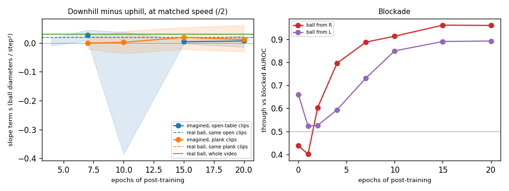
*Right panel: the blockade score rises steadily until about epoch 15, then flattens.
The right side learns first; the left side lags by about 3–5 epochs (it has a third of the
clips). Left panel: the slope term, section 6.*

**What the curve shows:**

- Learning stops at about epoch 15, under this cosine schedule.
- Run F (30 epochs, queued) will show whether a longer schedule moves the plateau, or whether it
  is a data limit.
- The dip at epoch 1 is probably the predictor leaving its pretrained solution before it
  learns the blockade.

## 6. Table slope: not learnt yet (new)

**Why test the slope.** The table is slightly tilted (downhill = left in the image). This is a
second hidden physical property the model could pick up from video.

**How it is measured.** At matched speed, friction cancels:

**s = (downhill acceleration − uphill acceleration) / 2**

s is in ball diameters per step², with 1 step = 1/8 s. Positions are mapped onto the table using
the ball's size. Nothing is fitted to read the model.

| track | s | 95% CI | stretches (down / up) |
|---|---|---|---|
| real ball, whole video | **0.0299** | [0.027, 0.032] | 396 / 138 |
| real ball, plank clips | 0.0299 | [0.021, 0.039] | 26 / 38 |
| decoder on real frames, plank clips | 0.0254 | [0.006, 0.049] | 31 / 42 |
| decoder on real frames, open-table clips | −0.131 | [−0.42, 0.05] | 10 / 12 |
| imagined, pretrained | – (ball never drawn clearly) | – | 0 / 0 |
| imagined, C @ 20, open table | 0.0067 | [−0.015, 0.025] | 8 / 5 |
| imagined, C @ 20, plank clips | 0.0115 | [−0.031, 0.061] | 16 / 15 |

**Slope map** (uniform pull over the whole table, friction removed). g_x < 0 means pulled left
(downhill):

| track | g_x [95% CI] | stretches |
|---|---|---|
| real ball (tracker) | **−0.0265** [−0.030, −0.023] | 955 |
| frozen probe on real frames | −0.016 [−0.039, +0.029] | 355 |
| imagined, before post-training | – (no usable stretches) | 0 |
| imagined, after (C, 20 ep) | +0.007 [−0.012, +0.030] | 144 |

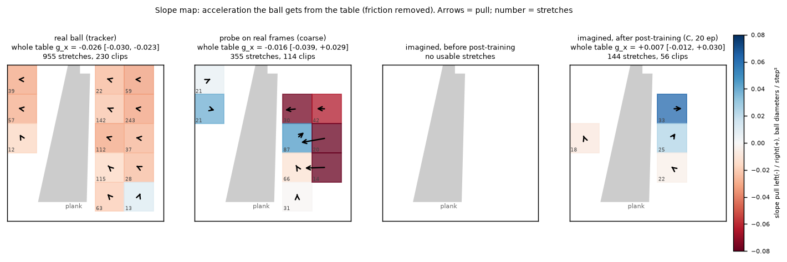
*Left: the real ball is pulled left (downhill) almost everywhere. Second: the frozen probe on
real frames can't recover this; its 32 px cells are too coarse for accelerations this small.
Right: the post-trained model's imagined ball shows no consistent downhill pull.*

**Reading:**

- The slope result is inconclusive rather than negative. Imagined s is about a fifth of the real
  value, with a CI that spans 0.
- There are too few stretches where the imagined ball is visible on open table (n 5–16).
- The readout is too coarse to see the slope even on real frames.
- A sharper, untrained position readout is built but not yet scored: the nearest real
  context patch (`nn_locate`, commit `07baaf3`). It is the next step for this test.

## 7. Zero-shot baselines (main, older 88-clip set)

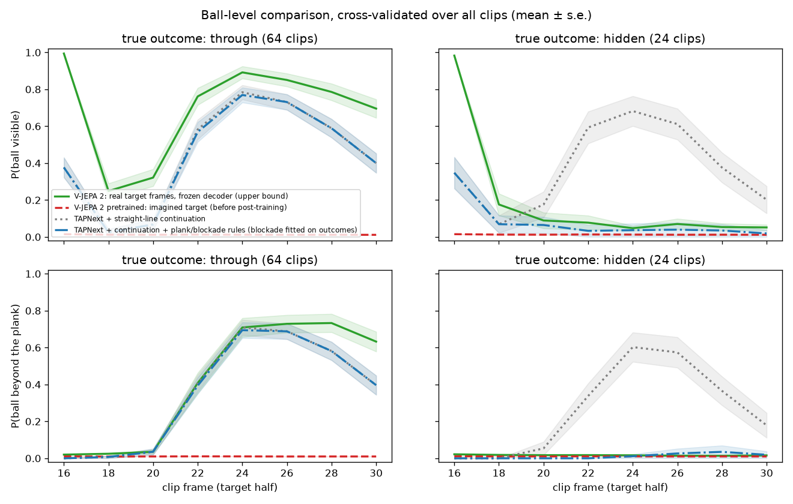

On the earlier `start.mp4` set, the pretrained V-JEPA imagined outcome AUROC was 0.40 (64/64
through passes called hidden), and TAPNext + fitted blockade reached 0.98. That blocker was in a
different place and the clips were easier. **On the current clips the bar is 0.85, not 0.98.**

## 8. My reading of the results (updated)

1. **Proof of concept: met, now on both sides.**
   - Right-entry passes reach 0.96, left-entry passes 0.89. The real-frame ceiling is 0.98–1.0,
     and the outcome-fitted tracker gets 0.85.
   - The readout cannot have learnt this: the decoder is frozen and blind to outcomes.
2. **Both through windows are now learnt.** Commit at 10 epochs got only the wide gap. The
   narrow gap came with loss-weighted sampling and 20 epochs (imagined 0.79 vs 0.91 real).
   The imagined ball is still fainter than the real one, mostly late in the clip.
3. **The one-direction question is answered.**
   - A right-only model learns an image-space outcome map that is inverted for balls from the
     left. The mirror test doesn't rescue it.
   - So "a blocker at a place" is not learnt from one direction alone. Seeing both directions is
     enough to get both right.
   - What's still open: whether C holds one shared blocker representation or two
     direction-specific maps. A moved-blocker or new-ball test would separate them.
4. **Training length matters more than objective tricks.**
   - Doubling the epochs gained more than any architecture change: the copy gate, the
     multi-hypothesis head and the objectives all made smaller differences.
   - C plateaus at about epoch 15.
5. **The slope is a measurement problem first.** The readout must see accelerations of about
   0.03 ball diameters/step² before we can say whether the model learnt the slope.

## 9. Future work (updated)

### Runs not done yet

| priority | run | state / why |
|---|---|---|
| 1 | Score the slope with the sharper `nn_locate` positions | Built (`07baaf3`), not scored. Without it, the slope test can't succeed even on real frames. |
| 2 | **E**: C plus the open-table clips in training, 20 ep | Waiting: `robustworld_clips_open.zip` must be added to the Kaggle dataset. Gives the slope far more free-rolling examples. |
| 3 | **F**: C for 30 epochs, scored at 25 and 30 | Queued. Tests whether the epoch-15 plateau moves with a longer schedule. |
| 4 | **D**: the other ball, scored without training | Waiting: the clips and `configs/heldout.json` aren't added yet. First held-out *object* test. |
| 5 | `interpret` (change maps, layer patching) for C | Only plain has been interpreted. Would show whether both directions share one representation. |
| – | 3-way bounce score with `away_from_plank` | Ready on PR #4; rescore only. |
| – | "Known blocker" panel | Needs the blocker outline in `configs/scenes/whole.json`. |
| dropped | rollout, codes_rollout, gate_hyp_commit, frac-50/25, the old 30-epoch runs | Dropped in favour of B, A and C (RESEARCH_SCOPE.md). |

### Directions I think are most promising

1. **Moved-blocker recording (most informative next video).** Train C on position A, then test
   on position B:
   - with zero-shot scoring, it should fail;
   - after a few clips of fine-tuning, it should adapt fast if it represents "an object at a
     place".

   This is now the cleanest test of a real blockade model, since both directions are solved.
2. **Counterfactual sweep.** Paste the ball at many heights in one context and plot imagined
   P(blocked) along the plank. That gives the model's own blockade map with no outcomes. If one
   shared map appears for both entry directions, C holds one blocker representation.
3. **Surprise as a second score.** Path-matched surprise separates outcomes even before
   training. If C is less surprised by blocked passes only inside the blockade rows, that is
   label-free evidence of a location model.
4. **Sharper imagined ball.** The imagined far-side ball is still fainter than real. Options:
   - **discrete latent modes** (a small VQ "outcome" latent, learnt self-supervised);
   - an **adversarial** realism term (the discriminator must never see outcome labels);
   - **object-slot sparsity** (keep changes on the ball tokens).
5. **Slope, done properly.** Score `nn_locate` positions, add open-table clips (run E), and
   consider a recording with a stronger tilt so the effect is well above the readout's noise.
6. **Imitation-from-observation pick-up policy.** Use C to imagine *where and when* the ball
   crosses the line, read through the frozen decoder, and use that as the policy's target.
   - Start with a planner that moves the gripper to the predicted crossing point.
   - Then learn from human demonstrations, e.g. action-conditioned prediction in the style of
     V-JEPA 2-AC.
   - Success metric: pick-up rate on through vs blocked passes. A blockade-aware model shouldn't
     reach for balls that never arrive.
