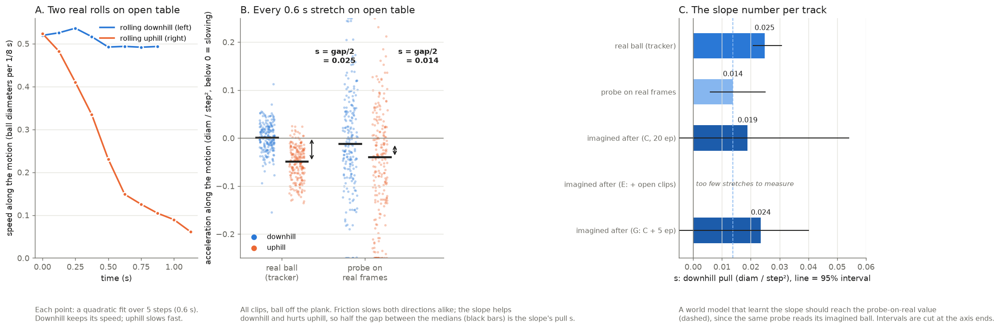
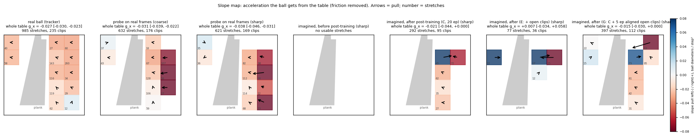
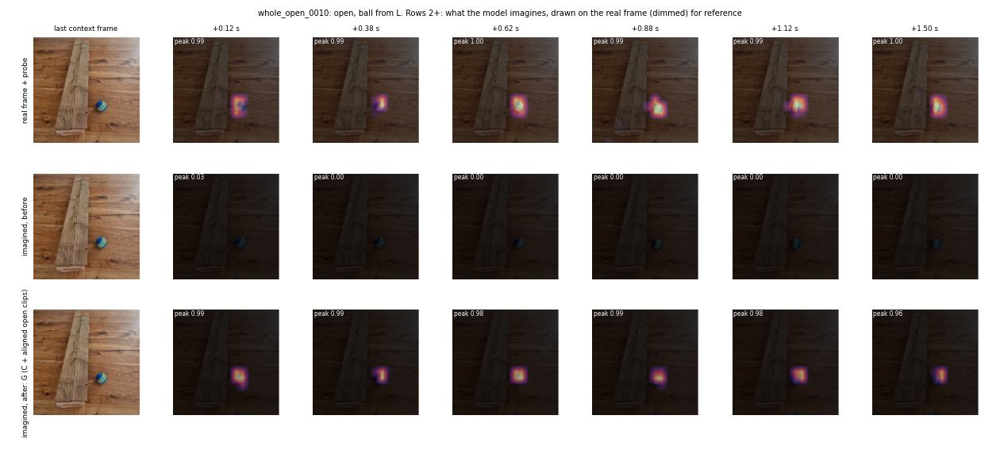
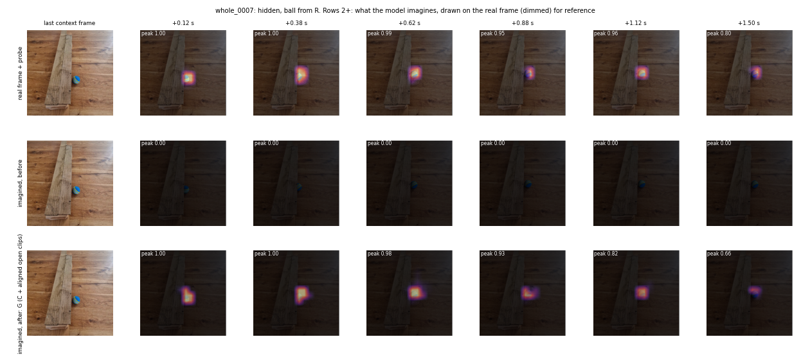
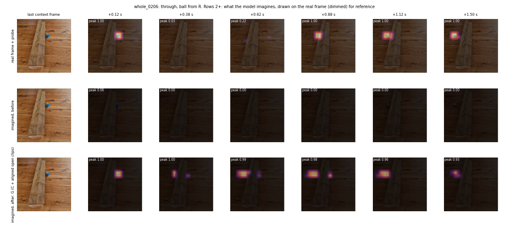
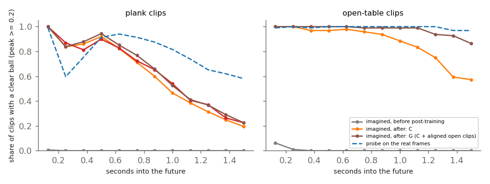
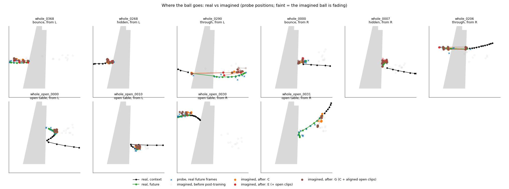

# Table slope results (15 Oct 2026)

Page with all figures: https://claude.ai/artifact/35TFdsN52WM5oufPvpBWBD
Figures: `slope/` next to this file. Source: branch `claude/colab-two-day-plan-3gn90a`, results `results/2026-10-04_2110_twoday/vjepa2/plan/` (Kaggle run 14:37 UTC, code cd5d046; figure tidy 7ea53cd).

## The number

Downhill pull s = (downhill − uphill acceleration along the motion) / 2, in ball diameters per step² (1 step = 1/8 s). Every number uses the same stretches as the real ball, and friction cancels out. The frozen probe reads about half of the real pull, so a model that has learnt the slope should land near the probe-on-real value.

| track | s | 95% range | stretches (down/up) |
|---|---|---|---|
| real ball (tracker) | 0.025 | 0.021 to 0.031 | 202 / 216 |
| probe on real frames | 0.014 | 0.006 to 0.025 | 202 / 216 |
| imagined, C (lossmix both, 20 ep) | 0.019 | −0.019 to 0.054 | 70 / 65 |
| imagined, G (C + 5 ep aligned open clips) | 0.024 | −0.007 to 0.040 | 124 / 92 |
| imagined, E (C + old mistimed open clips) | too few stretches | | 2 / 28 |

Whole-table pull from the slope map (g_x, negative = downhill): real −0.027, G −0.015 (−0.030 to 0.000), C −0.021 (−0.044 to 0.000).

## The imagined ball, frame by frame

Rows: the real future frames with the probe, then imagined before post-training, then imagined after (G).

## What it says

- Both post-trained models pull the imagined ball downhill, at or above the probe level. G has more usable stretches and a tighter range than C, but its range still just reaches zero, so the slope is likely but not proven.
- G keeps the imagined ball clear far longer on open table: 87% of clips at 1.5 s, against 57% for C. Before post-training, the imagined ball is never visible.
- G keeps the blockade. Through-vs-blocked AUROC is 0.971 from the right (C 0.961) and 0.873 from the left (C 0.893).
